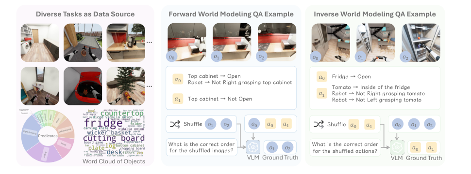
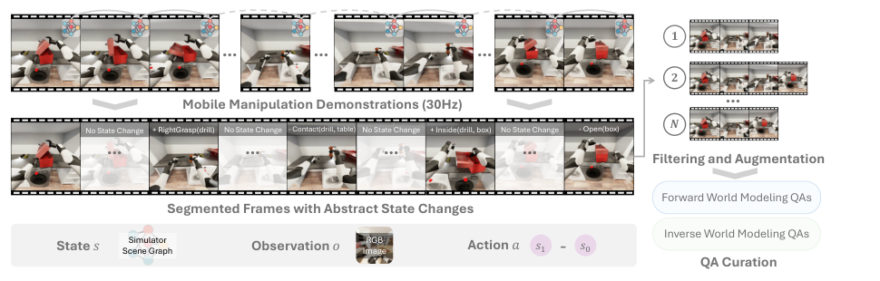

# 论文阅读：ENACT 到底需要复现什么

来源：用户提供的 *ENACT: Evaluating Embodied Cognition with World Modeling of Egocentric Interaction*，60 页。页码均为 PDF 页码。本文围绕复现和迁移解读；[完整原文文本](evidence/paper_text.txt)及[1,216 个原文块索引](evidence/source_map.json)保留了全篇检索入口，不将本文件称为全文翻译。

## 1. 研究问题和产物

ENACT 把第一视角交互中的世界建模能力转成两类**序列重排 VQA**。模型读取多张 RGB 图和文本动作，输出一个整数排列。它评估的是模型理解状态转移的能力，不要求生成未来视频，也不直接控制机器人。

**Original:** “Although we do not train or finetune VLMs here” （p.2，S0047）

**中文：** 本文没有训练或微调 VLM。因此第一阶段应复现数据构建和评测闭环，训练 LoRA/VLA 属于之后另立的实验。

论文主要贡献是任务定义、可扩展的数据生成与验证流程，以及对 VLM 的诊断实验。POMDP 是问题建模框架；复现代码不需要先训练一个 POMDP 求解器。

## 2. 三个核心对象

| 符号 | 原论文含义 | 水下迁移时的对应物 |
|---|---|---|
| `o_t` | 机器人第一视角 RGB 图 | USIM `ego` 相机的一帧 |
| `s_t` | 由仿真状态得到的符号场景图 | 带物体身份、关系、状态的水下标注；29 维本体状态不是它 |
| `a_t` | 两个采样状态间的可见场景图差分 | 如“机械爪开始抓住红圆柱”；13 维控制向量不是它 |

**Original:** “the action connecting consecutive key frames is the visible scene-graph delta” （p.4）

**中文：** 相邻关键帧之间的动作，由可见场景状态差分定义。跳帧后的一个动作可以包含多个原子变化，而不是一条瞬时电机命令。

例如，“夹爪闭合”和“抓住物体”是不同事件：只有闭合命令，不能证明抓取已经发生。类似地，推进器输出不能直接证明机器人已经接近目标。

## 3. 双向任务与步数

| 方向 | 已知输入 | 被打乱的内容 | 输出 |
|---|---|---|---|
| Forward | 当前图、正确顺序的 `L−1` 条动作 | 后续 `L−1` 张图 | 未来图标签的正确排列 |
| Inverse | 按时间顺序的 `L` 张图 | `L−1` 条动作 | 动作标签的正确排列 |

**`L` 是图像/状态数量，动作和答案长度是 `L−1`。** “3 steps” 对应 3 张状态图、2 条动作、2 个答案数字。初始图固定，不参加前向排序；逆向任务的图像不打乱。来源：p.4、p.28–30、代码两个 generator。

**Original caption excerpt:** “We provide examples for (mid) forward world modeling and (right) inverse world modeling.” （Figure 3，p.5）

**中文图注：** 中间展示前向任务，右侧展示逆向任务。复现时必须保留这两种不同的打乱规则。图注出现“real robots”，但正文 §2.3 明确主数据来自 BEHAVIOR 仿真；另有独立真实视频实验（p.7–8），不能把主数据描述为真实水下或真实机器人数据。

## 4. 数据构建流程

**Original caption excerpt:** “The trajectory is then segmented by identifying key-frames where an abstract state change occurs” （Figure 2，p.3）

**中文图注：** 从同步的 RGB 和场景图中筛选抽象状态发生变化的关键帧，再采样关键帧轨迹，构造两类题目。

1. 从同一条交互轨迹获取同步的图像、完整状态和场景图（p.3–4）。
2. 在谓词或关系变化处选取关键帧，抑制瞬时抖动和重复状态（p.4、p.22–23）。
3. 按时间前后关系建 DAG。只有变化有意义且视觉可验证的帧对，才允许连边（p.23–25）。
4. 用动态规划计数，通过加权回溯采样长度为 `L` 的有效路径；允许跳过中间关键帧（p.25，Algorithm 1）。
5. 从每条采样路径生成状态差分文本，再分别打乱未来图或动作（p.4–5）。

复杂度不是“把所有组合都导出来”。`C(M,L)` 只是组合候选的上界，经过可见性、语义变化与去重过滤，实际有效路径和输出数量会更少。同一 episode 产生大量 QA，也不会增加独立物理轨迹的数量。

**Original:** “persists for at least 40 frames. At our simulator’s 30Hz rate” （p.23，S0366）

**中文：** 论文用 30 Hz 下约 1.3 秒的持续时间作为可调稳定性条件，并报告 0.97 的签名相似度阈值。USIM 为 10 Hz，不能把 40 帧原封不动照搬。当前代码也与这段描述有差异，见 [02](02_code_and_reproduction.md)。

## 5. 指标：不能只比较排列数字

**Original:** “Multiple valid answers can exist for a given question” （p.5，S0121）

**中文：** 同一道题可能有多个语义有效顺序。原评测器把预测重建为状态变化，验证它是否满足题目的约束。

设第 `i` 个正确转移的可见签名为 `C_i`，较完整的参考签名为 `F_i`：

- 前向：预测图像顺序隐含的转移签名需要覆盖参考可见变化，即 `C_i ⊆ predicted_i`。
- 逆向：预测选中的动作签名需要是该位置参考转移的子集，即 `predicted_i ⊆ F_i`。
- 答案长度相同、所有位置通过语义检查，或数字排列完全匹配，均可使 Task Accuracy 计为成功。

原理和公式见 p.27–28。注意代码在 `partial_diff=False` 时仍经过可见性处理，不能把它理解为不受观测约束的完整物理状态。

| 指标 | 应如何理解 |
|---|---|
| Exact Match（EM） | 输出排列与采样参考排列是否完全相同 |
| Task Accuracy（TA） | 全题是否被 verifier 接受；通常为 EM 或 semantic match |
| Pairwise Accuracy（PA） | 对齐位置上的动作—状态转移匹配比例；不是所有标签两两相对先后关系的准确率 |

长度不匹配时，代码还会用单调对齐给部分分。跨 `L` 汇总时，论文写的是按转移数微平均，但本地代码是逐题 PA 的均值。固定 `L` 且答案长度正常时二者一致；混合长度时可能不同。迁移版应同时记录口径，不能把 EM、TA 和 PA 混称“排序准确率”。

## 6. 原实验设置

| 项目 | 论文设置与来源 |
|---|---|
| 主数据 | 29 类 BEHAVIOR 活动，每类选 1 条轨迹；共 8,972 QA（p.5） |
| 双向数量 | README 示例报告 Forward/Inverse 各 4,486；最终复现以实际冻结数据清点为准 |
| 长度 | `L=3…10`，每个方向、每个长度约 560 题，近似均衡（p.5、p.26） |
| 输入 | 统一按 512×512 处理，多图输入（p.5、p.34） |
| 解码 | temperature=0；每个方向使用统一 prompt；输出可解析的 Python 整数列表（p.34–35） |
| 模型 | 正文称 7 个专有、23 个开放权重模型；型号列表见 p.34，完整成绩见 p.36–37 |
| 人工 | 3 名标注员；240 题交叉标注，一致性 α=0.8320（p.28、p.33） |
| 额外真实数据 | 3 个日常场景，960 QA，人工关键帧和场景图（p.7–8） |

论文结果显示：长轨迹更困难、逆向通常好于前向、模型整体弱于人工。它们是原数据上的结论；在 USIM 上应重新检验，不能作为水下实验的预设结果。原论文没有提供水下性能或 USIM 上训练改进的证据。

## 7. 哪些附加实验适合迁移

论文还研究了图像真实感、FOV、相机高度、机器人外观、左右手偏差（p.7–10、p.38–47），并分析实体替换、谓词替换、极性反转、遗漏与幻觉（p.10–12、p.47–59）。

水下第一阶段优先研究 `L`、Forward/Inverse、操作/导航、ego/wrist 可见性。浑浊度、光照、视角变化可作为后续控制实验，但需要同轨迹重渲染或明确的配对增强协议；单靠已有视频不能声称控制了原物理条件。USIM 的单机械臂设置不能直接复刻原文双手偏差分析。

论文消融使用 Welch 非配对检验（p.39）。若水下方案对同一 QA 的两种视觉条件做比较，建议采用以 episode 为单位的配对不确定性分析，并报告多个 QA 共享轨迹的依赖关系；这是迁移实验建议，不是对原论文代码已经实现的描述。

## 8. 限制与证据边界

**Original:** “we do not explore finetuning VLM in this work” （p.13）

**中文：** 原论文没有验证微调收益。迁移阶段先做零样本评测，之后再单独设计训练、验证和测试协议。

真实视频实验只覆盖有限日常场景；生成照片风格的图像也不等于真实数据。主任务是离线推理代理指标，不能由它推导出闭环导航成功率或水下控制稳定性。

## 9. 全篇定位索引

| 页码 | 内容 |
|---|---|
| 1–2 | 摘要、动机与“不训练模型”的范围 |
| 3–5 | 任务公式、关键帧和主数据集 |
| 6–11 | 主结果、真实图像、视觉/具身偏差与结构错误 |
| 12–14 | 相关工作、限制、伦理、复现声明 |
| 14–20 | 参考文献；本轮未逐条进行外部引文真实性审计 |
| 21–28 | 附录目录、符号、分帧、DAG/DP、谓词和语义评分 |
| 28–35 | QA 示例、人工界面、一致性和模型 prompt |
| 36–43 | 完整结果、接触谓词、动作编码、消融、生成图像和噪声 |
| 44–47 | 相机配置、机器人外观 |
| 47–59 | 签名、错误类别、手部混淆与算法 |
| 60 | LLM 使用声明 |

术语统一：egocentric observation＝第一视角观测；scene graph＝场景图；predicate＝谓词；visible delta＝可见差分；key-frame trajectory＝关键帧轨迹；action signature＝动作签名。原文块 ID 和英文术语表保存在 `source_map.json`。
