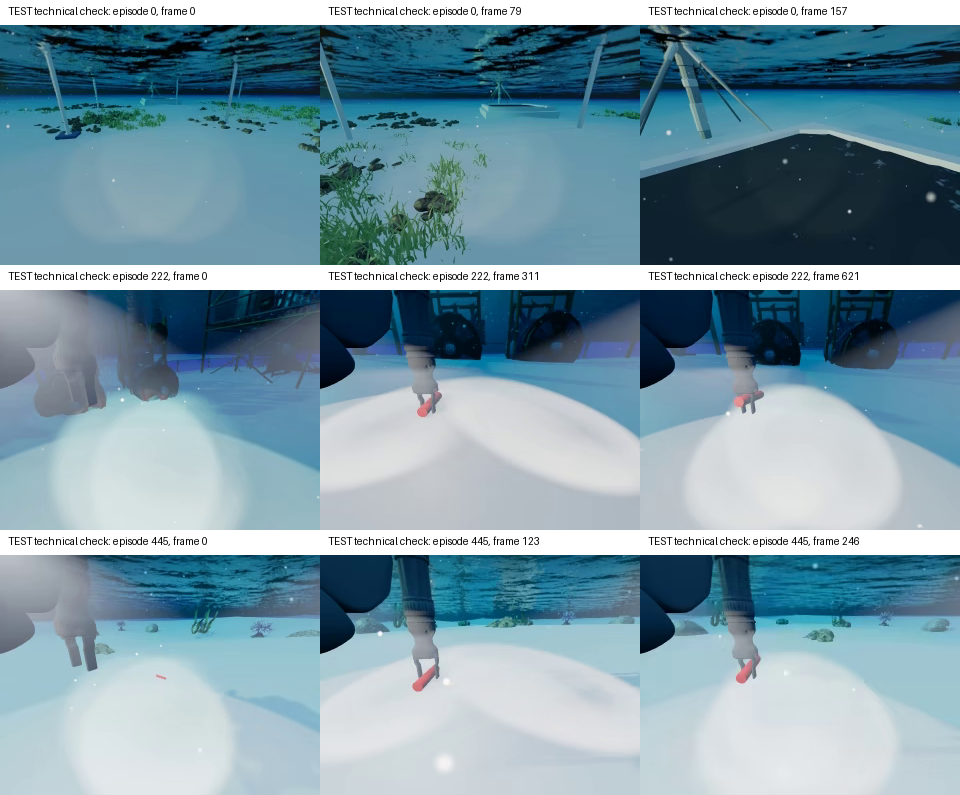

# USIM 本地数据核验

> **2026-10-23 后续更新：数据已补齐。** 原下载工具漏处理 tree API 分页，导致把未列出的文件误判为上游缺失。现已获取全部 7 页、6,840 个文件（4,219,493,970 字节），逐文件内容哈希核验全部通过。train 为 1,750 个 Parquet / 3,500 个双视角视频，test 为 525 个 Parquet / 1,050 个双视角视频；全部 Parquet footer 总帧数与 meta 一致，另抽读 6 个 Parquet 和 12 个视频。最新证据：[下载记录](../../usim/_download_manifest.json)、[哈希核验](../../tools/_hfcache/verification.json)、[读取检查](../../tools/_hfcache/readability.json)、[补下载说明](../../tools/README.md)。下文 21:07 左右的数量与“尚未下载完整”描述保留为历史审计快照；语义标注缺口不因补齐文件自动消失。

数据位置：`E:\code\UW-VLM\usim`。本文件区分数据卡声明、本地文件实测和待核实语义；当前数量是 2026-10-23 的快照，后续下载可能改变。机器证据：[usim_audit.json](evidence/usim_audit.json)、[local_status.json](evidence/local_status.json)、[video_probe.json](evidence/video_probe.json)。

## 1. 数据集身份与完整性

本地 README 标题为 **USIM: Underwater Simulation Dataset for Vision-Language-Action Models**，介绍 Stonefish 仿真、BlueROV2 加机械臂、LeRobot v2.1 和 ego/wrist 双相机。数据卡声明 2,275 episodes、20 个任务变体、9 类语言指令、9 个水下场景。该介绍不能替代逐文件完整性核验。

| 项目 | 数据卡/元数据目标 | 2026-10-23 21:07 +08:00 动态快照 |
|---|---:|---:|
| train episodes | 1,750 | 947 个 Parquet 已出现，其中本轮扫描读取 768 个 |
| train frames | 696,990 | 已读取部分 292,382 行；不是训练集总量 |
| train videos | 3,500 | 0 |
| test episodes | 525 | 525 个 Parquet，可全量读取 |
| test frames | 208,605 | 208,605 行，与 test/info.json 一致 |
| test videos | 1,050（两相机各 525） | 461 个 ego，0 个 wrist |
| test 元数据 | 5 个标准 meta 文件 | info、modality、tasks、episodes、episodes_stats 均存在 |
| ENACT 语义场景图 | USIM 原发布未在本地提供 | 未发现 |

**目录仍在新增文件，本次不存在整库稳定快照。** 最新扫描的 `source_unchanged_during_scan=false`，`declared_asset_counts_complete=false`，所以审计退出码为 1；这是未完成下载的状态，不是已读 Parquet 损坏。上表文件数来自 `local_status.json` 的瞬时清点，可读数量来自稍早的 `usim_audit.json`，二者不要求相同。训练集 meta 尚未到位，不能把其部分帧数当作完成状态。视频已存在不代表完整或可全部解码，本轮只抽查了 3 个已到位视频。

test/info.json 内部的 `splits={"train":"0:525"}` 是其作为独立 LeRobot 数据根的索引定义。**它不会把外层 `test/` 变成可用于调参的训练集。** 实验划分按外层 USIM train/test 来源记录。

## 2. Parquet 实测字段

525 个文件使用一致的 Arrow schema：

| 字段 | 实测类型/维度 | 可用来做什么 |
|---|---|---|
| `observation.state` | float32[29] | 机械臂/推进器/传感器状态的候选特征 |
| `action` | float32[13] | 控制命令，辅助候选动作分段 |
| `target_pos` | float32[6] | 含义与有效性需核实，不能直接认定是目标物体真值位姿 |
| `timestamp` | float32 | 时间同步，实测帧间隔约 0.1 秒 |
| `frame_index` | int64 | episode 内 0 起始、连续帧序号 |
| `episode_index` | int64 | episode 索引，与文件名一致 |
| `index` | int64 | 发布数据的全局行索引，不能代替 split/episode 复合主键 |
| `task_index` | int64 | 9 类语言指令的映射键 |

RGB 存在独立 MP4 中，不在 Parquet 行内；需要按视频路径模板和帧序号读取。

实测检查：525/525 文件全量读取成功；状态、动作和 target_pos 的维度及有限数检查通过；每段 frame_index 从 0 连续递增、时间严格递增、episode 内 task_index 唯一。没有由这些检查推导任务成功率或物理语义正确率。

## 3. 数据卡有一处不能照抄的维度说明

README 把 `joint_pos` 写成 6 维，同时又给 `0–5` 和紧随其后的 `5–13` PWM；这是有歧义且重叠的写法。**test/meta/modality.json 明确采用半开区间：**

| 状态切片 | 维度 | 元数据名 |
|---|---:|---|
| `[0:5]` | 5 | joint_pos |
| `[5:13]` | 8 | pwm |
| `[13:18]` | 5 | joint_v |
| `[18:21]` | 3 | dvl_v |
| `[21:24]` | 3 | imu_av |
| `[24:27]` | 3 | imu_la |
| `[27:28]` | 1 | pressure |
| `[28:29]` | 1 | dvl_h |

action 同样是 `[0:5]` joint_pos 加 `[5:13]` PWM，共 13 维。具体哪一维是夹爪、关节顺序、弧度/归一化单位、推进器几何与符号、控制量是目标位置还是增量，仍需上游采集/机器人配置确认。不能只凭列名完成“向前/抓取”的文本映射。

info.json 的 `robot_type` 为 `AgileBot`，而 README 描述 BlueROV2 平台；这可能是导出时的通用标签，当前不能独立据此确认机器人动力学或控制约定。

## 4. target_pos 的限制

全量数值核验发现 **7,373 行的 target_pos 六维全为零**。这只是观察值，不自动等于缺失值或真实原点；文件没有提供足以在本轮确认其物理含义、坐标系和有效性的标签。

使用前应找到上游源码或数据提供者的说明，确认：target 是任务目标、末端目标还是控制参考；位姿相对于谁；轴方向和单位；姿态参数顺序；哪些任务/帧有效；零向量如何解释。即使能确认它是某个目标的相对位姿，也不能由单个目标位姿推出所有物体的接触、抓取、容纳关系或像素可见性。

## 5. 9 类指令与 20 个任务变体

本地 tasks.jsonl 及全量 Parquet 的 test 分布一致：

| task_index | 指令 | test episodes |
|---:|---|---:|
| 0 | Go to the charge station | 30 |
| 1 | Pick up the pipe | 120 |
| 2 | Pick up the blue cylinder | 120 |
| 3 | Scan the ship | 30 |
| 4 | Inspect the pipeline | 30 |
| 5 | Follow the boat | 15 |
| 6 | Pick up the red cylinder | 120 |
| 7 | Pick up the red cylinder and transfer it to the box | 30 |
| 8 | Go to the water tower | 30 |

同一 task_index 合并了多个场景、目标或干扰物变体。episodes.jsonl 记录指令和长度，没有单独给出数据卡的全部 task code、场景 ID 和生成种子映射。若要报告浅海/工厂、颜色干扰等切片，需要补建可靠的任务目录；不能凭 episode 数字猜场景，也不能把 9 类指令写成已核验的 20 个独立场景标签。

## 6. 读取环境和兼容性

本机基础 Python 为 `D:\tools\anaconda\python.exe`，3.13.5，原 PyArrow 为 19.0.0；Parquet footer 显示 writer 为 Arrow 23.0.1。Arrow 19 读取标量列时可复现：

```text
OSError: Repetition level histogram size mismatch
```

本轮在 `%TEMP%\codex-enact-audit-20261023` 隔离安装 `pyarrow==23.0.1`，全量读取后通过；没有覆盖基础环境，也没有“修复”或重编码原始 Parquet。因此目前证据支持读取器版本兼容问题，而不是宣布源文件损坏。正式环境建议使用经验证的版本并固定依赖。

## 7. 视频技术抽查

已用本机 OpenCV 解码 ego 的 test episodes 0、222、445，各抽查首帧、中帧、末帧，9/9 次读取成功。视频报告为 10 FPS，帧数分别为 158、622、247，与对应 Parquet 行数一致。



这些测试集画面仅用于技术兼容性和数据结构检查，没有用于选择 prompt、阈值或模型。本轮没有对全部视频执行逐帧完整性检查，也没有验证 wrist 相机。以后仍要检查解码后的实际帧数、时间对应、丢帧和视角可辨认性。

上游 ENACT 的 `frame_extraction.py` 把视频首帧存成 `00001.png`，USIM frame_index 从 0 起。水下转换器建议首帧命名 `00000.png`，按元数据明确对齐；不能直接沿用默认 helper 导致一帧偏移。

## 8. 当前还缺什么

| 能力 | 当前材料是否足够 | 后续补充 |
|---|---|---|
| 连续 RGB、控制、本体状态 | 发布格式具备；本地下载未齐 | train、剩余 ego、wrist 和固定版本 manifest |
| 抓取/放置等语义事件真值 | 不足 | 人工事件/场景图或仿真物体状态与接触数据 |
| 导航进度的可靠定义 | 不足 | 目标坐标语义、机器人/目标位姿及可见性，或人工标注 |
| 所有物体身份与关系 | 不足 | 物体实例目录、关系标注 |
| 每个视角的可见性 | 不足 | 真分割掩码或人工可见性/指代审查 |
| 20 变体/场景切片 | 当前 meta 不足 | 上游任务映射或经核验的人工任务目录 |
| 原 ENACT 语义评测 | 不足 | raw 与 segmented 场景图、统一标签本体 |

初次审计时，`tools/hf_snapshot_download.py` 没有实现递归 tree API 分页。后续已修正：遍历所有分页、与同一提交的完整文件集合交叉核验、固定 commit，并按内容哈希复用完整文件。缺失的 4,856 个文件已从官网补齐；操作方式和最终证据见本页顶部的更新说明。
