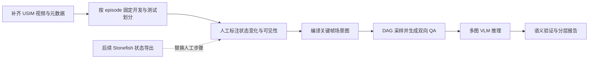

# 将 ENACT 迁移到 USIM 的实施方案

最近更新：2026-10-27（Asia/Shanghai）。

> **状态（2026-10-27）**：本文是（历史，2026-10-23 设计稿），§1–§6 的路线、标签本体与关键帧设计已按此实施；**§7“以下文件是建议新增的接口，当前尚未实现”已过时**：`enact/adapters/{usim_reader,usim_annotations,usim_scene_graph,usim_translator,usim_visual_prompt}.py` 与 `scripts/usim/{build_dataset,build_qa,evaluate,run_inference}.py` 均已实现并在 v0.1/v0.2 使用（[07 §1](07_reproduction_run.md)、[评分契约与统计](WBW/ENACT-USIM-评分契约与统计-20261027.md)）；v0.2 语义变更（`OnSeabed` 物理支撑、`NextTo` approach、at_box 的 `NearBox`）见 [v0.2 标注与关键帧规范](WBR/ENACT-USIM-v0.2标注与关键帧规范-20261027.md)。模型与推理后端已于 2026-10-24 选定并跑通（[执行结果](WBW/ENACT-USIM-qwen3.8-max-执行结果-20261024.md)），§8 的“本轮没有选定模型或推理后端”为历史状态。

目标是构建“水下第一视角交互的前向/逆向世界建模评测”。保留 ENACT 的动作条件、双向排序和语义验证；重新定义水下状态、可见性、动作描述和数据协议。以下是设计方案（历史，2026-10-23 设计稿；原“尚无已经完成的 USIM 转换器或正式水下 QA”的表述已过时，实现状态见上方状态框）。

## 1. 选择路线

| 路线 | 额外材料 | 能复现到什么程度 | 建议 |
|---|---|---|---|
| A. RGB + 人工事件/关键帧场景图 | 已有视频，人工标注物体、关系、可见性、变化 | 小规模可建立可审查的 ENACT 风格语义评测 | **先采用，验证可行性** |
| B. Stonefish 状态导出或可靠轨迹重放 | 原场景、机器人配置、物体/接触状态、初始条件、同步与重放能力 | 可扩展的语义场景图生成 | A 跑通后争取，不能假定已具备 |
| C. 低层控制量分段 + 图像排序 | 已有状态/action；还需验证运动方向映射 | 控制条件下的时序/运动代理任务 | 标签不足时可另设实验；不称完整 ENACT 复现 |

建议先做 A 的 **10–20 条训练来源 episode**，以抓取和搬运为主，产生约 100–200 道经审查的短题。这个数量是工作目标，不是现有产出；若语义变化不足，应报告实际数量，不用均匀抽帧补足。待定义稳定后，再把人工步骤替换为 B 的自动导出。

原版真实视频实验也是人工选择关键帧并标注场景图（论文 p.7），因此小规模人工方案有方法依据。自动生成百万 QA 的规模声明则必须等自动语义数据链真实完成后再讨论。



## 2. 第一阶段数据范围

先从 USIM **外层 train/** 划出独立开发/验证 episodes。候选任务为取红圆柱、取蓝圆柱、取管道和抓取后放入盒子；选视频清晰、能区分动作后果的轨迹。正式测试保留外层 test/，不能用当前测试集去调关键帧阈值或 prompt。

首版只使用 ego 相机，接近原文第一视角协议。wrist 可辅助标注，但**模型只看到 ego 时，题目必须在 ego 中具有足够证据**，不能把仅 wrist 可见的抓取变化当作 ego 的确定标签。双相机联合输入是独立扩展条件，应单独报告。

导航、巡检、跟随放在第二阶段：它们的语义变化可能比操作稀疏，且目标位姿、视野、距离和进度定义需要先核实。一个持续向前运动的视频并不自然包含 10 个独立语义状态。

## 3. 先确定水下标签本体

以下是候选，而非已存在的 USIM 真值：

| 谓词/事件 | 语义 | 最低证据 | 不能替代它的信号 |
|---|---|---|---|
| `Grasping(robot, object)` | 夹爪实际持有目标 | 夹爪—物体相对运动/接触的可靠判定或人工确认 | 夹爪闭合命令 |
| `Inside(object, box)` | 目标进入容器 | 几何关系真值或可审查的视频标注 | 末端驶向盒子 |
| `OnTop(object, support)` | 目标位于并接触支撑物 | 接触/空间状态或人工判断 | 画面中上下排列 |
| `Near(robot, goal)` | 达到预定义距离范围 | 有效目标/机器人位姿、单位与阈值 | 未知语义的 target_pos |
| `Aligned(robot, goal)` | 满足预定义对准条件 | 坐标系、姿态真值、阈值 | 单个 PWM 分量的符号 |
| `Reached(robot, goal)` | 达到任务定义的目标区域/条件 | 数据提供者成功条件或明确新协议 | 视频结束或停止运动 |
| `Visible(object, camera)` | 在该视角有可辨认的像素证据 | 分割掩码或人工可见性标签 | 目标距离小、相机前方的推测 |

首版优先实现可可靠标注的 2–4 个操作谓词；`Near/Aligned/Reached` 在坐标与目标语义未确认前禁用。标签状态至少区分 `true / false / unknown`。未知不能写成 false，更不能把 unknown→true 当作已证实的 false→true 状态变化。

每个物体保留稳定 `object_id`、类别、颜色和可辨认描述。多个蓝/红干扰物不能统统叫“cylinder”，也不要通过伪造类别名避开上游多实例过滤。应改进实例指代规则；无法用模型可见输入唯一指代的样本应剔除。

## 4. 标注与真值生产流程

1. 选择训练来源轨迹，读视频及同步 Parquet；记录 split、episode、原帧序号、时间和相机。
2. 人工标出事件边界与前后稳定帧，填写物体、谓词、极性、可见性和不确定项。保留原视频上下文，避免用两张静态图误判接触。
3. 在候选关键帧上建立一致的场景图快照。人工流程不需要假装已有每一帧的完整图；未标注的区间不能通过无依据的插值变成真值。
4. 对可能连边的非相邻帧，重新核查端点差分与可见性。即使中间发生过“抓住→松开”，端点完全相同也可能没有可问的净变化。
5. 独立复核一部分样本，记录分歧和裁决。建议覆盖每个谓词、每种任务和两种方向，先确认标签可信度再扩规模。

用 VLM 生成候选描述可以节省标注时间，但必须与人工或仿真证据复核，记录标签来源；不应把被评模型或同类模型的未审查输出当成确定真值。

## 5. 对接 ENACT 的状态格式

推荐适配层维护一份带 `unknown` 和来源信息的中立标注；编译到上游格式时，只导出**已经确认且在该题相关范围完整标注**的谓词与关系。上游场景图的“没有这个谓词”会被当成不存在，因此不能直接丢掉 unknown 后对整个图做闭世界差分。

过渡目录可以采用：

```text
data/usim_enact/<version>/
  manifest.json
  split_manifest.json
  annotations/episodes.jsonl
  annotations/events.jsonl
  annotations/scenes/<episode_key>.json
  replayed_activities/<episode_key>/
    scene_graph_0.json
    external_sensor1/00000.png ...
  segmented_activities/<episode_key>/
    segmented_scene_graph_0.json
    external_sensor1/<frame_id>.png
  QA/<split>/enact_ordering.jsonl
  predictions/<model>/<split>.jsonl
  evaluation/<model>/
```

为复用上游单相机 reader，可在适配输出中将 `ego` 映射为 `external_sensor1`，保留原相机名和映射记录。原始 USIM 文件不改名、不移动。手工关键帧方案可以直接编译到 segmented 阶段，避免在稀疏人工标注上运行要求稠密输入的上游 `segment`。

上游可见性字段是 `[obj_pixel_count, xmin, ymin, xmax, ymax, height, width]`。只有真实掩码才填写真实像素计数；人工只给布尔可见性时，应通过明确的 visibility provider 适配或修改 reader，不能编造包围框和像素数以通过阈值。

## 6. 关键帧和路径采样

优先用语义谓词变化选帧；控制量变化、图像差异和光流只用于提出候选。稳定时长、最小间隔、谓词滞回、重复变化抑制均用秒或明确的物理量配置。

论文 1.3 秒条件换算到 10 Hz 约 13 帧，可作为开发阶段的候选值，但不等于已验证适合水下任务的默认值。上游 `TEMPORAL_THRESHOLD=200` 在 USIM 中相当于 20 秒，可能压掉大量可用变化，不能原样使用。

首轮只生成 `L=3/4`。每条题的每个转移都要求：非空、有语义、可在输入视角辨认、指代唯一、无未知状态差分。再根据 episode 的有效关键帧数和 DAG 路径数决定是否扩至 `L=5…10`。报告长轨迹缺失的任务，不能用重复/等距帧拼成长时域结果。

同一路径生成前向和逆向两题；记录共享 `trajectory_id`，以便进行方向比较。随机化未来图/动作展示标签，保留 identity permutation 的自然概率，并检查标签分布与固定顺序捷径；不能假设每题一定发生非恒等打乱。

## 7. 模块改造清单

以下文件是**建议新增的接口，当前尚未实现**（历史，2026-10-23；截至 2026-10-27 均已实现，见文首状态框）：

| 建议模块 | 工作内容 | 可复用部分 |
|---|---|---|
| `enact/adapters/usim_reader.py` | LeRobot 元数据、Parquet、视频同步、全局 episode key | Pillow/OpenCV 基础依赖 |
| `enact/adapters/usim_annotations.py` | 标签本体、unknown、人工/仿真证据和快照编译 | 场景图数据结构 |
| `enact/adapters/usim_visibility.py` | ego/wrist 视角可见性与实例指代 | reader 的可见性调用接口 |
| `enact/adapters/usim_segmentation.py` | 秒级时间参数、状态变化关键帧、质量标记 | DAG/DP 思路；不直接照搬上游硬编码选帧 |
| `scripts/usim/build_qa.py` | 固定 split/seed，双向配对、数据审计、QA 输出 | 两个 generator；先解决 seed、实例过滤和图片根目录 |
| `scripts/usim/run_inference.py` | 模型调用、多图输入、仅传白名单字段、断点续跑 | 上游 prompt 模板 |
| `scripts/usim/evaluate.py` | 严格校验、固定分母、EM/TA/PA、分层报告 | 上游 verifier；在新协议中明确修改点 |

优先保留原版 scorer 为对照，增加适配 scorer/包装器及版本号。修改多实例、解析或 unknown 处理后必须重新生成和冻结题集，不要把不同协议的 records 拼接为一次结果。

## 8. 最小模型试验

选择一个确实支持多图、能固定版本和解码参数的 VLM。若已有本地服务可先使用，但需确认它能接收 `L` 张图而非只保留首图/末图。也可用 Qwen2.5-VL-3B/7B 作为与论文型号接近的候选；最终模型取决于现有 GPU/服务条件，本轮没有选定模型或推理后端（历史，2026-10-23；2026-10-24 已选定 `qwen3.8-max` 并跑通，见 [执行结果](WBW/ENACT-USIM-qwen3.8-max-执行结果-20261024.md)）。

先在开发集运行 20–50 题，核验图片顺序、标签、答案、失败处理和断点；随后冻结协议，才运行独立测试。每个 QA 原始输出、实际请求的图像/文本哈希、模型快照、视觉预处理和解码设置都要保存。

保留随机排列、固定顺序、去除动作文本的前向对照，以及逆向仅动作文本对照，检查模型是否依靠视觉证据。控制条件需作为独立实验标注，不与正式统一 prompt 的分数混算。它们的作用是检查任务有效性，不预设模型一定优于这些基线。
