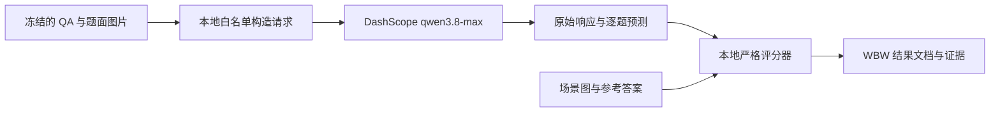
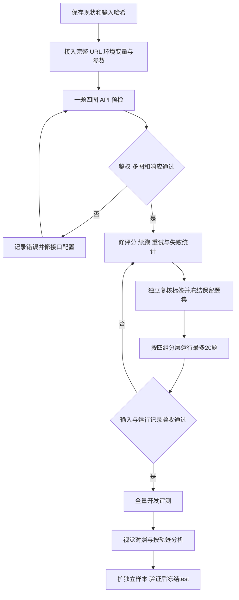

# ENACT × USIM：DashScope API 完整实施方案

更新日期：2026-10-24（Asia/Shanghai）。项目：`E:\code\UW-VLM\ENACT`。本方案替代 [上一版通用流程](ENACT-USIM试运行后续流程方案-20261024.md)，评测模型固定为用户指定的 **`qwen3.8-max`**，通过阿里云 DashScope 的兼容接口调用。当前工作是调用已有模型做推理评测，本地负责数据、请求、记录与评分，不需要先训练模型或部署 GPU 推理服务器。

**最近目标：先验证一题四图的 API 请求，再修复评分与运行记录，独立复核现有标签，完成分层 20 题试跑及全部保留题评测。** 后续再做视觉对照、扩展独立轨迹与最终测试。本文是完整实施方案；本轮查阅了官方接口文档、核对了本地代码，尚未使用密钥发起模型请求，也未执行后续修复、标注或正式评测。

## 1. 固定配置与当前事实

### 1.1 用户指定的接入配置

| 项目 | 本轮固定值 | 处理方式 |
|---|---|---|
| 服务 | 阿里云 DashScope，Chat Completions 兼容接口 | HTTPS POST |
| `VLM_API_URL` | `https://dashscope.aliyuncs.com/compatible-mode/v1/chat/completions` | 完整请求地址；请求时直接使用 |
| `VLM_MODEL_NAME` | `qwen3.8-max` | 不擅自替换模型或更换服务地域 |
| `VLM_API_KEY` | 使用用户提供的密钥 | 仅从当前进程环境读取；文档、源码、配置、报告不保存值 |
| 任务 | ENACT forward / inverse ordering | 每题 3–4 张图片，输出 `1…L−1` 的排列 |

2026-10-24 查阅的 [阿里云视觉理解文档](https://help.aliyun.com/zh/model-studio/vision) 已将 `qwen3.8-max` 用于图像输入示例，并说明单次请求可传多图。[兼容接口文档](https://help.aliyun.com/zh/model-studio/qwen-api-via-openai-chat-completions) 说明图片支持 Base64 Data URL，HTTP 请求可在顶层传入 `enable_thinking`。公开文档核验不能替代该密钥、该账户与该地址的实际调用验证；实际权限、配额及返回行为由单题预检确认。查阅摘录保存在 [WBW 接口证据](../WBW/evidence/dashscope_official_docs_20261024.json)。

### 1.2 已有数据与已发现的问题

| 对象 | 已有情况 | 下一步怎么用 |
|---|---|---|
| USIM | `E:\code\UW-VLM\usim`；当前下载清单声明完整，固定 commit `88c3612bf99d10652f19ec531052a38c04f0202e` | 核验本轮实际使用的源文件；不重复全量下载 |
| 现有题集 | `data\usim_enact\usim-enact-v0.1`；7 条 train episode、28 帧、70 题 | 保留历史原件；单题 API 预检可直接引用其中图片 |
| 题目分层 | forward L=3 / L=4 为 28 / 7，inverse 为 28 / 7 | 20 题试跑必须覆盖这 4 组，不能简单截取前 20 行 |
| 视觉记录 | 21 个相邻转移标为可见且非空，标签来源为 `agent_visual_review` | 仍需独立复核“能看见物体”与“能判定谓词” |
| 现有成绩 | oracle 全对；其余为随机、恒等、逆序、空和畸形输出基线 | 没有真实 VLM 成绩；oracle 不代表模型能力 |
| 工程问题 | PA 加权分母漏失败题、verifier 错误跳题、strict 解析抽取列表、续跑仅检查 ID | 在正式模型成绩前修复，并保存修复验证 |

完整问题与已有数字见 [WBW 试运行复核](../WBW/ENACT-USIM试运行复核与补充清单-20261024.md)；对应 [审计证据](../WBW/evidence/trial_audit_20261024.json) 包含顺序解码、哈希、题面映射及评分边界探测。现有 7 条轨迹作为开发材料，test 不参与选帧、prompt 或参数选择。

## 2. 接入时必须先处理的三个细节

### 2.1 完整 URL 与 base URL 不能混用

当前 `scripts/usim/run_inference.py` 的 `call_openai()` 会在 `--base-url` 后追加 `/chat/completions`。因此，不能把用户给出的完整地址直接作为现有 `--base-url`，否则会形成重复路径。

建议增加 **`--api-url`，表示完整 URL 并直接 POST**，默认从 `VLM_API_URL` 读取；保留 `--base-url` 作为旧兼容入口。二者同时显式指定时拒绝启动，避免猜测。若暂时沿用旧入口，应仅传 `https://dashscope.aliyuncs.com/compatible-mode/v1`，由脚本追加后缀。配置记录完整解析后的最终 URL，并在本地无网络校验中验证路径只出现一次。

### 2.2 密钥从环境变量读取

当前脚本默认 `--api-key=EMPTY`，**不会自动读取 `VLM_API_KEY`**。需要改成从环境变量取值并在缺失时明确报错；正式调用命令不再通过命令行参数传密钥。模型名同样支持 `VLM_MODEL_NAME`，但显式参数与环境值的优先级必须写清。

PowerShell 会话可按以下方式设置。此段只配置当前会话，不向项目文件或系统永久环境写入密钥；输入框中填用户提供的值即可。

```powershell
$env:VLM_API_URL = 'https://dashscope.aliyuncs.com/compatible-mode/v1/chat/completions'
$env:VLM_MODEL_NAME = 'qwen3.8-max'
$vlmSecret = Read-Host '输入 VLM_API_KEY' -AsSecureString
$vlmKeyPtr = [Runtime.InteropServices.Marshal]::SecureStringToBSTR($vlmSecret)
try {
    $env:VLM_API_KEY = [Runtime.InteropServices.Marshal]::PtrToStringBSTR($vlmKeyPtr)
} finally {
    [Runtime.InteropServices.Marshal]::ZeroFreeBSTR($vlmKeyPtr)
    $vlmSecret.Dispose()
}
Remove-Variable vlmSecret,vlmKeyPtr
```

归档配置只保存 `api_key_env: VLM_API_KEY` 和 `api_key_present: true/false`，不保存 Authorization、密钥、密钥片段或其哈希。运行结束可执行 `Remove-Item Env:VLM_API_KEY` 清除该会话中的值。

### 2.3 固定思考模式，避免采用模型默认值

官方文档说明 Qwen3.8 系列默认开启思考。首轮定义为 **`qwen3.8-max / thinking=false` 基线**，显式关闭思考，使用短文本最终答案；需要测思考模式时另建独立条件，不能混在同一分数中。

| 参数 | 首轮设定 | 验收与记录 |
|---|---|---|
| `model` | `qwen3.8-max` | 保存请求模型名与响应中的实际 model 字段；别名不等于永久固定的权重快照 |
| `temperature` | `0` | 预检确认服务接受；不把 temperature=0 写成绝对可复现保证 |
| `enable_thinking` | `false` | 直接 HTTP 时放在 JSON 顶层；只有使用 OpenAI SDK 才放 `extra_body` |
| `stream` | `false` | 第一轮沿用完整 JSON 响应，避免在接入时同时引入流解析 |
| `max_completion_tokens` | `64`，待预检确认 | 短排列通常足够；`finish_reason=length` 仍算截断/无效，不能拼接修复 |
| `timeout` | `180` 秒 | 保存实际耗时与超时；思考模式另定预算 |
| 并发 / 请求间隔 | `1` / 建议 `1` 秒 | 起步串行；该间隔不是服务配额保证，按实际 429 和账户限制调整 |
| 传输重试 | 最多 `3` 次尝试，含首次 | 仅针对可重试传输/服务错误，所有尝试留痕 |
| 系统提示 | 固定现有 `You are a careful visual reasoner. Answer exactly as instructed.` | 与题干共同冻结；若预检后决定调整，统一改配置并重新开始对应 run |

以上是方案参数，不宣称本账户已接受。任何参数不支持，应保存错误、查明接口规则并更改整个运行配置，不得按题悄悄删参数、改模型或切思考模式。官方文档建议新接入使用 `max_completion_tokens`，故不默认沿用即将废弃的 `max_tokens`。

## 3. 数据如何进入模型



参考答案、场景图、正确帧号和时间线仅在本地评分使用。API 请求只包含固定系统提示、题干和 `images` 指定顺序的图片内容；不序列化整条 QA，不上传原视频、Parquet、本体状态或关节信号。

HTTP body 的结构如下，图片数据在运行时从本地 PNG 编码生成，下面不是可直接发出的真实图片请求：

```json
{
  "model": "qwen3.8-max",
  "temperature": 0,
  "enable_thinking": false,
  "stream": false,
  "max_completion_tokens": 64,
  "messages": [
    {"role": "system", "content": "You are a careful visual reasoner. Answer exactly as instructed."},
    {"role": "user", "content": [
      {"type": "text", "text": "冻结题干"},
      {"type": "image_url", "image_url": {"url": "data:image/png;base64,<第一张题面图片>"}},
      {"type": "image_url", "image_url": {"url": "data:image/png;base64,<第二张题面图片>"}}
    ]}
  ]
}
```

每题实际加入全部 L 张图。forward 的未来图按打乱后的展示顺序，inverse 的图片按题面时间顺序；输出标签以图内文字为准。逐图记录路径、SHA-256、尺寸与请求槽位，日志不复制长 Base64。模型只返回最终排列，例如 `[2,1]` 或 `[3,1,2]`；不得用参考答案纠正模型输出。

## 4. 执行顺序与每一步的完成条件



单题预检只验证接入，不产生正式成绩，因此可先引用 v0.1 的一题开展，不必等完成人工复核。20 题试跑和全量正式开发成绩必须在评分及标签门槛通过后执行。不把“必须答对”作为接口接通的标准。

## 5. 阶段 A：保存版本与实现最小 API 接入

**执行角色：工程负责人。**

1. 保存现有 manifest、标注、QA、题面图片、基线 report/items、预测和当前源码清单及 SHA-256。ENACT HEAD 为 `87e323a985418f7dcb09e9f62d065a9d010ce98b`，但当前未跟踪的适配器/脚本必须另记源码哈希。
2. 修改 `run_inference.py`：实现完整 URL、环境变量、固定模型与思考参数；发请求前检查题集、图片、ID 和配置；保留原始响应和 usage。`call_openai()` 当前只返回文本，需要扩展为返回结果对象。
3. 建立单写入者的 run 目录。记录时间、请求模型、服务 URL、提示与输入哈希、解码、重试、图像处理和环境版本；不保存密钥。
4. 加入不发请求的 `--dry-run`：验证最终 URL、配置必需项、L 张图片可读、ID 唯一及输入哈希，只输出脱敏摘要。模型白名单输入与本地评分真值分开处理。

新增或扩展的 CLI 接口建议如下，**这些不是当前脚本已经支持的全部参数**：

| 接口 | 约定 |
|---|---|
| `--api-url` | 完整地址；未传则读 `VLM_API_URL`，与显式 `--base-url` 互斥 |
| `--model` | 未传则读 `VLM_MODEL_NAME` |
| `VLM_API_KEY` | 必需环境变量；不出现在正式命令行或归档配置中 |
| `--enable-thinking false` | 控制实际 JSON boolean，不把字符串 `"false"` 当作真 |
| `--max-completion-tokens 64` | 固定答案长度预算 |
| `--max-attempts 3` | 总尝试次数，含首次 |
| `--dry-run` | 无网络检查，不能视作 API 成功 |
| `--resume` | 仅在输入、配置和代码评分版本兼容时恢复；不能只看 ID |

**验收：** 无网络检查能确认用户 URL 没有重复后缀，密钥缺失时明确失败，日志中没有 Authorization；4 张 PNG 按指定槽位进入候选请求，gt/正确帧号不进入 API payload。

## 6. 阶段 B：一题四图 API 预检

**执行角色：推理负责人。依赖：阶段 A。** 从现有 forward L=4 组固定选择 1 题，将 QA 副本、ID 和哈希保存到预检 run；引用 v0.1 原图，不覆盖原题面。此次请求单独记录为 `preflight`，不并入正式评测。

成功条件为：HTTP 请求成功；服务接收 4 张图片而非仅第一张；响应有可读的最终 content；usage、响应 model、请求 ID（服务提供时）和 finish_reason 被保存；题面标签与请求图片顺序对应。若模型答错但返回合法列表，接口仍可能是通过的，另记预测错误。一次正常响应本身不能完全证明模型理解了所有图片，可用明确要求区分两张图片内容的附加诊断进行验证，单独记录，不计入 ENACT 成绩。

错误按下表处理：

| 返回/现象 | 处理 |
|---|---|
| 401/403 | 核查密钥、权限与地域；停止该 run，不循环重试鉴权错误 |
| 404 或 model 不可用 | 分别检查最终 URL 与模型权限；不擅自换模型或路由 |
| 400 参数或多模态格式错误 | 保存脱敏错误码/信息，核对图片 Data URL、思考参数和 token 参数；修订配置后新建 run |
| 429 限流 | 依据 Retry-After（如有）及账户配额退避；若是余额/配额耗尽则停止并记录原因 |
| 408、部分 5xx、网络断连或超时 | 按统一策略有限重试；记录每次尝试、耗时与可能重复计费的不确定性 |
| HTTP 200 但 content 为空、截断或结构异常 | 记录原响应与原因；不抽取 reasoning_content 冒充最终答案，不自动加长预算挑最好答案 |

**交付：** 预检配置、输入清单、脱敏原响应、逐题状态、usage 和错误信息。公开文档支持模型与多图，不等于本账户的这一步已经通过。

## 7. 阶段 C：先修评分与恢复机制

**执行角色：工程负责人。依赖：阶段 A；可以与接口排查分别推进。**

| 修改项 | 规则与验收样例 |
|---|---|
| 固定 PA 分母 | `PA_micro = sum(PA_i × n_i) / sum(n_i)`，全部冻结题贡献 `n_i=L_i−1`；L=3 全对 + L=4 缺失时必须为 0.4，而不是当前的 1.0 |
| 资产/verifier 错误 | 正式评分前预检查；缺必需场景图/图片或 verifier 失败即返回非零、run 标失败；不跳题后生成可误用的正式分数 |
| 严格解析 | 对字符串整体 `strip()` 后解析唯一数组；重复、越界、布尔、非整数、解释文本、多列表、缺失、错误长度都记 invalid/0；不正则抽取最后一个列表 |
| ID 与计数 | QA ID 唯一；预测不能有重复或未知 ID；缺失仍计入分母；attempted、API成功、合法排列与最终失败分别计数 |
| 传输重试 | 最多 3 次尝试；可重试错误建议等待 2、4 秒并加少量抖动，有 Retry-After 时优先遵守；若超过运行可接受等待则停止本轮并保留可恢复状态 |
| 输出错误 | 合法但错误的排列、格式错误或截断不因分数重试；传输重试规则与模型答案质量无关 |
| 断点恢复 | 比较 QA/图片/配置哈希与模型、prompt、思考模式；成功项不重复请求，最终失败保留，尚未完成项可恢复；换配置必须新 run |
| 写入与退出 | append 的 attempt 日志可有同 ID 的多次尝试；供 scorer 读取的最终 predictions 每 ID 一条；批次完成状态区分 completed / completed_with_failures / failed |

JSON 格式损坏的尾行不能静默忽略或覆盖；恢复时先校验文件并记录修复过程。超时请求可能已在服务端完成，不能承诺网络重试恰好一次或绝不重复计费。

`evaluate.py` 的报告同时记录 `dataset_version` 与 `evaluation_protocol`。如果只修评分而标签/题面不变，可继续引用冻结 v0.1 数据并用新评分协议，如 `usim_strict_v0.2`；不能把评分版本变化误写成重新采集了数据。若修改标签、选帧或题面，则生成新数据版本并重跑全部相关模型。

**交付与验收：** 评分修复 diff、6 种基线回归、混合有效/缺失、缺资产、严格格式、重复 ID、配置变化拒绝续跑等边界证据。所有冻结题进入分母；服务器请求失败只影响预测得分，不允许删题。另用人工可读的合成例子验证多答案 TA 与不可交换顺序，当前 70 题的所有合法排列枚举结果是 TA 与 EM 等价。

## 8. 阶段 D：独立复核标签并冻结开发输入

**执行角色：独立于首轮的复核者。依赖：新评分/输入协议已确定。**

1. 对 28 帧、21 个相邻转移与题集中跳帧转移全部登记复核。第一轮只看模型实际收到的图片，不展示原标注、关节状态、gt、真实帧号；记录每个谓词真/假/未知及可判定性。
2. 再查看视频与辅助信号核查物理事件。将“物理上成立”和“ego 输入中可判定”分列；只能靠关节信号或另一相机确认的变化，不作为 ego-only 主结果的视觉真值。
3. 重审 `NextTo` 在抓住后变 false 的含义：几何接近与“接触前接近阶段”需明确区分；必要时重命名、改词表并升数据版本。同样复核 `OnSeabed=false`、`Lifted=false` 的中间状态是否可见且定义一致。
4. 保留 unknown 与争议。当前编译器拒绝 scope 内 null：可排除相关帧/题，或对整个 episode 去掉不可靠关系并重建路径；不能逐帧漏标后当 false。独立裁决前不进入主结果。
5. 保留原始与复核值、裁决、证据范围、复核者、排除原因；不依据模型是否答对删题。`Inside/InBox` 需单独证明，不能以任务指令、箱口悬停或释放控制量代替观察结果。

如果修改标注/图片，输出到 `data\usim_enact\usim-enact-v0.2`，保持 v0.1 原件。只排除歧义题也须冻结新 QA 清单及其哈希，并说明实际数量；不能仍声称无条件完成原 70 题。每个保留题须 ID 唯一、L 张图可读、映射正确、参考转移非空，且 oracle 全对。

**交付：** 标注指南、逐帧/转移复核表、分歧裁决、保留/排除清单、新 manifest。现有 `annotation_status=reviewed` 不能替代这一步；oracle 是自洽检查，不是独立标注质量证明。

## 9. 阶段 E：分层 20 题试跑，再做全量开发评测

从验收后的 QA 按 forward/inverse × L=3/4 分成 4 组，固定 seed `20261024`，每组最多取 5 题，共最多 20 题，优先覆盖现有 7 条 episode 与不同任务。某组不足时如实报告；抽样不参考 gt 值或模型成绩。当前文件先排列 forward L=3，因此 `--limit 20` 不等于分层抽样。

保存 `smoke.jsonl`、`full_dev.jsonl` 和各自 ID/哈希。试跑核验所有图片进入请求、服务稳定、格式错误与网络错误分列、失败也有记录。格式有效率 95% 可作为开发调试目标，不是删题或后处理答案的理由；真实准确率低不阻止保存结果。

下列命令是**阶段 A–D 完成、新 CLI 已实现后的执行模板，不是当前原脚本即刻支持的命令**。示例默认引用未变更的 v0.1；若阶段 D 重建 v0.2，则将 `dataRoot` 改为新版本并冻结相应 QA。两个输入 JSONL 要在发请求前准备好。

```powershell
Set-Location 'E:\code\UW-VLM\ENACT'
$py = 'C:\Users\whuang\.workbuddy\binaries\python\envs\default\Scripts\python.exe'
$dataRoot = 'E:\code\UW-VLM\ENACT\data\usim_enact\usim-enact-v0.1'
$runRoot = 'E:\code\UW-VLM\ENACT\data\usim_enact\runs\qwen3.8-max\dev_ego_thinking_false_001'
$smokeQa = Join-Path $runRoot 'inputs\smoke.jsonl'
$fullQa = Join-Path $runRoot 'inputs\full_dev.jsonl'
if (-not $env:VLM_API_KEY) { throw '当前会话未设置 VLM_API_KEY。' }
if (-not (Test-Path -LiteralPath $smokeQa)) { throw '先生成分层 smoke.jsonl。' }
if (-not (Test-Path -LiteralPath $fullQa)) { throw '先冻结 full_dev.jsonl。' }

# 无网络检查；最终完整 URL 从 VLM_API_URL 读取
& $py 'scripts\usim\run_inference.py' --backend openai `
  --data-root $dataRoot --qa $smokeQa `
  --api-url $env:VLM_API_URL --model $env:VLM_MODEL_NAME `
  --enable-thinking false --max-completion-tokens 64 --max-attempts 3 `
  --timeout 180 --sleep 1 --dry-run `
  --out (Join-Path $runRoot 'smoke\predictions.jsonl')
if ($LASTEXITCODE -ne 0) { throw '无网络检查失败。' }

# 最多 20 题分层试跑
& $py 'scripts\usim\run_inference.py' --backend openai `
  --data-root $dataRoot --qa $smokeQa `
  --api-url $env:VLM_API_URL --model $env:VLM_MODEL_NAME `
  --enable-thinking false --max-completion-tokens 64 --max-attempts 3 `
  --timeout 180 --sleep 1 `
  --out (Join-Path $runRoot 'smoke\predictions.jsonl')
if ($LASTEXITCODE -ne 0) { throw '试跑未通过，检查 run_status.json。' }
```

试跑输入、服务和记录通过验收后，才执行下一段。试跑若导致参数或 prompt 调整，重新冻结配置并用新 run 路径；不能把旧试跑预测混入新配置。

```powershell
# 全量保留题；单独文件，不把 smoke 的调用次数当新增样本
& $py 'scripts\usim\run_inference.py' --backend openai `
  --data-root $dataRoot --qa $fullQa `
  --api-url $env:VLM_API_URL --model $env:VLM_MODEL_NAME `
  --enable-thinking false --max-completion-tokens 64 --max-attempts 3 `
  --timeout 180 --sleep 1 `
  --out (Join-Path $runRoot 'full\predictions.jsonl')
if ($LASTEXITCODE -ne 0) { throw '先核对全量 run 状态，保留已完成及失败记录。' }

# 使用修复后的严格评分器
& $py 'scripts\usim\evaluate.py' `
  --data-root $dataRoot --qa $fullQa `
  --predictions (Join-Path $runRoot 'full\predictions.jsonl') `
  --out (Join-Path $runRoot 'full\report.json')
if ($LASTEXITCODE -ne 0) { throw '评分资产或协议失败，不能发布正式成绩。' }
```

运行器建议以 `completed_with_failures` 表示全批已遍历但部分请求最终失败，并允许对完整固定 ID 集合评分；退出码与状态文件要有明确约定。上述命令按“失败返回非零”展示保守停止点，出现该状态时应先核对计数，再按既定规则评分失败题为 0，不能为获得全成功而无限重试。

**验收：** 全量 N 个冻结 ID 都有最终状态，预测无重复，失败/缺失计 0，评分分母 N；保存原响应、usage、输入/配置哈希和逐题分数。若保留全部原题，N=70；若复核后减少，报告实际 N 与原因。

## 10. 阶段 F：视觉对照与结果解释

对照使用同一个 `qwen3.8-max`、同一思考设置与解码配置，以及成对的语义题目；不同输入条件分目录保存图片、QA 和预测。正式比较使用各条件共同通过质量复核的 ID 集合，排除规则在看成绩前冻结。

| 条件 | 输入 | 要回答的问题 |
|---|---|---|
| A：原始 ego | 现有全图及清晰 State 标签 | API 模型在当前正式观测条件下的基础能力 |
| B：全图＋局部图 | 每个 State 的全图与夹爪/物体局部图，显式关联 State 标签 | 小目标可读性是否影响结果；图数与 token 不同，单独报告 |
| C：去图文本 | 相同题干，不传图 | 动作常识、措辞与固定排列先验能贡献多少 |
| D：程序基线 | oracle、identity、reverse、均匀随机排列 | 链条自洽、固定顺序及机会水平；本地运行，不消耗模型 API |

B/C 的数据构建和输入条件开关都需要实现，不能把“给图片列表留空”当作已经具备完整对照协议。局部图规则应只依赖图像或独立区域标注，不使用 gt、正确帧序、关节事件或模型答错位置选框；放大现有像素不能补回未采到的细节。wrist、双相机与更高原生分辨率属于独立观测条件。

当前 70 题按合法排列枚举的随机 EM/TA 期望是 0.4333，单次 random seed=0 的 0.3571 不是理论机会水平；forward L=3 的随机 PA 逐题期望是 0.625。新题集必须重新计算，不直接沿用旧数字。现有每题仅一个 TA 接受排列，所以不要把 TA=EM 解释为已验证多答案语义评测。

报告按 direction×L 展开 N、API成功数、合法排列数、失败/缺失/格式错误数、EM、TA、PA_item_mean、PA_transition_micro，并与 identity 和随机期望并列；再按任务与 episode 分层。比较 A/B/C 使用按 episode 的配对分析和分组 bootstrap；只有 7 个 episode 时仅作开发诊断，不能把 70 道相关题当成 70 条独立轨迹。

若 C 接近 A，先检查文本先验；B 高于 A 时结合独立复核判断可读性收益；A/B 都低但人能判定时保留模型错误；人也难判定时返回标签阶段。不要预设 API 模型一定胜过固定顺序基线。

## 11. 请求规模、费用与运行控制

保留原 70 题时，一轮原始 ego 全量为 **70 次请求、224 次图片输入**，未计重试。每题 L 张图应合在一次请求中，不能拆成 L 次单图回答再拼接排序。

| 阶段 | 计划请求数，不含重试 | 说明 |
|---|---:|---|
| 单题预检 | 1 起 | 一道 L=4；如需额外多图诊断，单独记账 |
| 分层试跑 | 最多 20 | 原题集可按 4 组各 5 题 |
| A 全量 | 70，或复核后的 N | 主要开发成绩 |
| B 与 C 对照 | 额外各 70，或各 N | 按同一语义 ID 配对；B 每题图数增加 |

首轮“1 + 20 + 70”为 91 次计划请求；再加 B/C 时合计 231 次，实际按重试、诊断与最终保留题数计账。次数不是价格，不能据此直接承诺费用。

保存每次响应提供的 `usage`：输入、输出及细分 token（如有），包括失败前已返回的 usage。费用按实际服务地域、计费阶梯、缓存、思考模式和运行时价格表核算；预检/试跑后给出全量费用估计，缺价格或 token 信息时报告 unknown。建议加入可配置的请求/token/费用预算及检查点，预算耗尽时保存状态退出，不启动后台无限重试。

`qwen3.8-max` 为模型别名时，保存调用日期、响应 model、服务 request ID 和提供者能给出的版本信息；无法固定底层快照时明确说明版本可能变化。不要为追求可复现性擅自改成另一个带日期的模型名。

## 12. 阶段 G：扩独立轨迹、补入箱与正式测试

先新增 20–30 条未使用的 train episode 作为资源规划目标，按任务分层、在看模型成绩前固定候选与抽样 seed，记录保留/拒绝原因。按 episode 分扩展开发和独立验证，可暂用 2:1；现有 7 条持续用于开发。方向、长度、重排、裁剪和相机变体全部跟随原 episode；若有可信 scene/trajectory ID，进一步成组。

优先增加独立轨迹与事件覆盖，再扩 L=5。L=5 需要 5 个可辨状态和 4 个可见语义变化；悬停多截帧、等间隔抽帧与同状态重复图不算新变化。当前词表无法支持时继续报告 L=3/4 的实际路径数。

transfer 任务先对现有 train 轨迹建立终态复核表，不从少量抽查外推“100/100 全未入箱”。若缺少可靠成功过程，再定位真实 Stonefish 采集工程，补采接近箱口、释放、沉降与稳定，释放后建议至少保留 1 秒观察窗口并以实际稳定为准。争取导出物体/夹爪/箱体位姿、坐标系、时间戳、接触/抓取及分割信息。仿真真值存在但 ego 因遮挡不可判定时，仍不强行加入 ego-only 题；`target_pos` 语义未核实前不推 Near/Reached/Aligned。

开发/验证完成后，冻结标签指南、可见性、选帧/裁剪、prompt、模型、思考模式、解码、评分版本及构建 seed，再构造并运行最终 test。test 不参与选择 prompt、模型或阈值。测试标签纠正需独立裁决、升版本并全条件重评，不能只删除模型答错题。未完成独立验证与冻结时，报告名保留“开发评测”。

## 13. 产物目录与结果文档

下面是目标结构，不表示目录与功能均已实现。原始 v0.1 不原地重建；如阶段 D 改标签，则另外建立 v0.2 数据目录。

```text
E:\code\UW-VLM\ENACT\
  data\usim_enact\
    usim-enact-v0.1\                 历史试点原件
    usim-enact-v0.2\                 标签/图片变更时生成
    runs\qwen3.8-max\<run_id>\
      run_config.json                 URL、模型、参数、代码哈希；无密钥
      input_manifest.json             数据版本、QA/图片/标注哈希
      inputs\                         preflight / smoke / full_dev 清单
      preflight\                      接入探测，独立于正式成绩
      smoke\
      full\
        attempts.jsonl                各次请求、状态、耗时与 usage
        responses.jsonl               脱敏完整响应，不保存请求鉴权头
        predictions.jsonl             最终每 ID 一行
        run_status.json               完成/部分失败/失败与计数
        report.json
        items.jsonl
  docs\WBW\                         实际执行记录、API证据、模型结果
  docs\WBR\                         当前方案、接口契约与操作说明
```

`run_config.json` 建议至少包含：`dataset_version, evaluation_protocol, api_url, api_key_env, model_requested, model_returned, enable_thinking, temperature, stream, max_completion_tokens, timeout_seconds, max_attempts, image_condition, system_prompt_sha256, qa_sha256, image_manifest_sha256, source_sha256, started_at`。响应中不存在的字段写 null，不伪造模型快照。

WBW 结果文档应依次写：执行范围与状态、数据/接口版本、请求成功和失败数量、分层指标与基线、视觉对照、典型错误、token/耗时/费用、已知限制、重跑命令与证据链接。没有执行的部分写“待执行”，不能沿用方案目标数量冒充结果。同步修正 `docs/README.md`、`05_next_steps.md`、`06_data_and_evaluation_contract.md` 中过时的下载、适配器、预测格式与严格评分说明。

## 14. 交付检查表

| 顺序 | 交付物 | 完成标准 |
|---:|---|---|
| 1 | 版本与脱敏配置 | 源码/输入哈希可定位，密钥不落盘，完整 URL 无重复后缀 |
| 2 | 单题四图预检 | 该账户实际请求成功，多图与最终 content、usage 可核对；不以答对为接口标准 |
| 3 | 评分/重试/恢复修复 | 固定分母与边界验收通过；所有尝试留痕；配置不兼容不能续跑 |
| 4 | 独立复核与冻结题集 | 保留题可从规定输入判定，unknown/争议/排除有记录 |
| 5 | 分层试跑与全量开发 | N 个 ID 全部有最终状态，固定分母，原响应与逐题分数完整 |
| 6 | 视觉对照与统计 | 同题配对，按 episode 分组，区分视觉不足与模型错误 |
| 7 | 扩展、验证与最终测试 | 协议冻结后才运行 test，变更有版本和全条件重评记录 |

本轮交付的是按指定 DashScope 配置重写的方案与公开文档核验记录。真正的下一步是阶段 A 的接入改造及阶段 B 单题预检；完成后把实际状态和结果补入 WBW，再按上述门槛推进。
