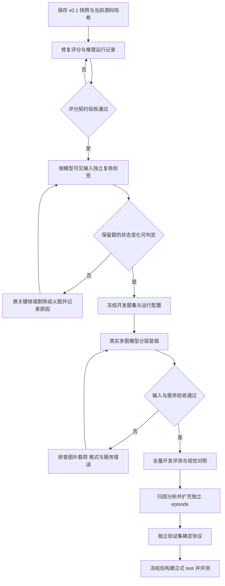

# ENACT × USIM 试运行后续流程方案

> 版本状态：本文件为通用方案历史稿，已由 [DashScope API 完整实施方案](ENACT-USIM-DashScope-API完整实施方案-20261024.md) 替代。当前按用户指定的 `qwen3.8-max` 与完整 DashScope URL 执行；以下保留原规划记录，不再采用其中本地服务占位命令。

日期：2026-10-24（Asia/Shanghai）。项目：`E:\code\UW-VLM\ENACT`。执行依据：[WBW 试运行复核与补充清单](../WBW/ENACT-USIM试运行复核与补充清单-20261024.md) 及其 [审计证据](../WBW/evidence/trial_audit_20261024.json)。

**目标：把已跑通的 7 条轨迹、70 道题试点，推进为标签可复核、模型输入可追踪、评分不丢分母的水下世界建模评测。** 先完成评分与标签门槛，再跑真实多图 VLM；获得可信基线后扩数据，最后冻结正式测试。本方案描述后续工作，不代表这些工作已执行。

## 1. 执行边界与当前起点

- 原始数据：`E:\code\UW-VLM\usim`。当前下载 manifest 声明完整，固定 USIM commit 为 `88c3612bf99d10652f19ec531052a38c04f0202e`。无需从头下载；只核验下一轮实际使用的文件。
- 现有试点：`E:\code\UW-VLM\ENACT\data\usim_enact\usim-enact-v0.1`。保留为历史基线，避免原地重建或重排。所有已看过的 7 条 episode 都归入开发用途。
- 已能复现：7 份标注、28 帧、70 题、6 种合成基线；真实模型预测尚无。21 个“可见转移”是已有标注结果，独立复核尚缺。
- 下一轮建议根目录：`E:\code\UW-VLM\ENACT\data\usim_enact\usim-enact-v0.2`。先明确新协议标识，再改相关常量/默认路径；不能仅换目录却继续在 manifest 中写 v0.1。
- 本项目的数据来源是 USIM/Stonefish，不能直接套用其他项目的 UE/HoloOcean 场景设置或存储约定。补采前先定位真实采集工程。

## 2. 总体流程与退回条件



不以“模型分数必须高”为过关标准。模型低分但数据、输入、评分可核验，也是有效结果；如果人只看输入图也无法判定，就先处理题集证据。

## 3. 阶段 S0：保存现状并固定来源

**执行角色：工程负责人。输入：现有 v0.1、当前脚本和本轮审计。**

1. 保存 v0.1 manifest、标注、QA、题面图片、基线 report/items、现有预测与当前源码的清单及 SHA-256。代码 HEAD 不能覆盖未跟踪的适配器和脚本，必须单独纳入。
2. 按试点记录核验实际使用的 Parquet、ego MP4 和 train 元数据；新清单同时记录源文件哈希、USIM commit、相机、帧号、标签来源。
3. 保留本轮 [审计脚本](../WBW/evidence/audit_trial_20261024.py) 和证据，作为旧版本行为记录。修复后另写新版验收证据；不要覆盖旧探测结果。
4. 为新一轮建立 `protocol.json` 和 `run_config.json`，保存 `protocol_version`、生成/重排 seed、环境依赖、代码哈希、QA/图像清单哈希、系统提示、模型快照、后端、图像预处理、解码与重试参数。不得记录密钥值。

**交付与验收：** `provenance/file_manifest.json`、`protocol.json`、环境清单；旧产物可按哈希对照，新运行有唯一目录。任一来源不明则写明 unknown 并暂停正式成绩发布，不必因此重下全数据。

## 4. 阶段 S1：修评分、运行记录与构建失败处理

**执行角色：工程负责人。依赖：S0。优先修改 USIM 适配脚本，明确记录与上游 ENACT 的差异。**

| 修改位置 | 要实现的行为 | 必须通过的验收样例 |
|---|---|---|
| `scripts/usim/evaluate.py` 的 `summarise()` | `PA_transition_micro = sum(PA_i × n_i) / sum(n_i)`；`n_i=L_i−1` 对全部冻结题累计，失败题分子为 0 | 一道 L=3 全对、一道 L=4 缺失，EM/TA/PA item=0.5，PA micro=0.4 |
| `evaluate.py` 的资产与 verifier 预检查 | 正式评分前检查所有依赖；资产或 verifier 错误使 run 失败，返回非零，不能生成标记为完成的正式成绩 | 缺任一必需场景图时失败；不能从 70 题缩成 60 题后继续报告准确率 |
| `parse_strict()` | 字符串首尾去空白后，整体解析成唯一整数排列；不得抽取解释中的列表、平移、截断或修复 | `[1,2]` 通过；解释文本、多个数组、重复、越界、布尔、非整数、错误长度、空串均 invalid |
| QA/预测加载 | QA ID 唯一；预测 ID 属于该题集；不得静默覆盖重复 ID；区分 attempted 与有效模型回答 | 重复 ID、未知 ID 明确报错；缺失 ID 保持在固定分母并记 0 |
| `run_inference.py` | 推理前检查全部图片；写配置 sidecar；恢复前比较模型、prompt、QA 和图片哈希 | 同 ID 的题面重排或换模型后，旧输出不能直接续跑 |
| `run_inference.py` 的状态与重试 | 对网络/限流/超时做有上限重试；最终失败仍留该 ID；失败行不能直接等同于成功 done | 中断后只续未完成项；请求失败次数与原因可查；最终评分不删除失败项 |
| `build_qa.py`、`reseed_answers.py` | 保存生成/重排 seed、拒绝原因、实际样本数；先写新位置；完成后统一冻结文本与图像 | 重排后旧预测被判不兼容；`--out` 写新 JSONL 也不能默默覆盖旧题面图 |

推理日志至少保存：`id`、原始响应、状态、错误类型、attempt、单次耗时、使用的配置哈希。现在预测是精简 `id+answer` 格式，而旧 `docs/06` 建议保留全部 QA 字段；新协议可继续用精简格式，但必须通过 QA 哈希和完整 ID 集合建立不可歧义的关联，并同步修正文档。

**交付与验收：** 修复提交或完整 diff、新评分版本标识、上述边界样例结果、6 种基线回归。新增“不同合法排列均可语义接受”和“必须拒绝交换”的人工可读契约样例，验证 TA 与 EM 的区别。只有所有冻结题计入、基础资产通过且完整记录被保存，才进入 S2。

## 5. 阶段 S2：独立复核标签与可观察性

**执行角色：独立于首轮标注的复核者，工程负责人负责整理。依赖：S1 的协议确定；复核工作可以在修代码期间先准备。**

本轮只有 28 帧，建议全部复核。对 21 个相邻转移和 QA 使用的跳帧转移都登记，不只抽查“看起来清楚”的例子。

1. **先做仅输入图复核。** 给复核者看模型实际接收的图，不展示关节状态、gt 排列、真实帧号或原标注答案。分别判断每个谓词的真/假/未知，记录证据是否足够。
2. **再做过程核查。** 看前后视频与辅助信号，判断物理事件是否发生。将“物理上确认”与“模型视角可判定”分列，避免辅助信号被偷偷算成视觉证据。
3. **修清谓词定义。** `NextTo` 若表示几何接近，抓住后不能无依据变 false；若表示接触前的接近阶段，则重新命名、更新词表和文本模板并变更协议。对 `OnSeabed` 与 `Lifted` 边界同样写清，避免人为拆出图中不可辨别的中间状态。
4. **处理 unknown。** 当前编译器拒绝 scope 内的 null，不提供完整三值差分。保留未知原始记录；编译时排除涉及未知的帧/题，或从该 episode 的整个关系 scope 去掉该谓词并重新检查可用路径。不能逐帧删除事实后当成 false。
5. **裁决分歧并重建新版本。** 保存原值、复核值、裁决、原因与源证据；有争议的题暂不进入主表。报告排除数量和原因，不以模型是否答对作为排除依据。

建议复核表字段：`episode_key, frame_or_transition, predicate, first_label, independent_label, visual_sufficient, auxiliary_confirmation, adjudicated_label, reason, reviewer, evidence_ref`。`unknown` 不参与简单真假一致率的分母而不说明，需单列其数量和比例；也不对只有 7 条轨迹夸大一致性统计。

**交付与验收：** `review/frame_review.jsonl`、`transition_review.jsonl`、`disagreements.jsonl`、新版标注指南、保留/排除 ID 清单。保留题的相关事实须无未解决分歧、每个参考变化非空且能从规定输入判定；oracle 全对仍需通过，但只作为程序自洽检查。若最终少于 70 题，如实报告新数量。

## 6. 阶段 S3：冻结开发题集并接入真实多图 VLM

**执行角色：推理负责人。依赖：S1、S2 验收通过；需要一个明确支持多图的本地或远端推理服务。**

### 6.1 先固定运行条件

第一轮选择一个稳定可访问的多图模型服务即可。模型名称只是配置的一部分，还需记录具体权重版本/服务版本、系统提示、temperature、服务是否接受该参数、输出长度上限和图片实际处理。现有“本机不能稳定运行 3B”的说法未经本轮实测，不能当成所有 3B/量化方案均不可行的结论；按实有服务与资源选定实现。

不需要在第一轮训练或微调。模型请求仅包含固定系统提示、题干、按展示顺序编码的图片；禁止发送 gt、正确时间线、视频帧号、文件名或整条 QA JSON。

### 6.2 先跑分层冒烟

从验收后的开发题集中按 `direction×L` 各取最多 5 题，共最多 20 题，覆盖 7 条 episode 和现有任务；固定抽样 seed 并保存 ID。某组不足 5 题时使用实际数量并记录，不能复制题目补齐。

**不要直接使用原文件的 `--limit 20` 作为分层冒烟。** 当前 QA 先排列 forward L=3，该参数只截前 N 条，会漏掉其他设定。应先创建独立的 `QA/dev/smoke_ordering.jsonl` 并显式传 `--qa`。

冒烟需要核验：每题应有 L 张图，图片内容与显示标签对应；所有图实际送达后端；原始响应留存；合法输出为 `1…L−1` 的排列；服务故障与模型格式错误能区分。格式有效率建议达到 95% 作为开发调试目标；这只是建议门槛，不能靠删题或自动修复答案达标。低准确率本身不阻止保存和分析结果。

### 6.3 完成全量开发运行

通过冒烟后，对保留题集运行同一配置；冒烟和全量使用独立 run 目录，避免更改配置后续写旧文件。示例命令使用现有参数名；**以下是 S0–S2 完成、目录与服务准备好后的模板，本轮未执行**：

```powershell
Set-Location 'E:\code\UW-VLM\ENACT'
$py = 'C:\Users\whuang\.workbuddy\binaries\python\envs\default\Scripts\python.exe'
$dataRoot = 'E:\code\UW-VLM\ENACT\data\usim_enact\usim-enact-v0.2'
$runRoot = Join-Path $dataRoot 'runs\dev_modelA_ego_001'
$baseUrl = 'http://127.0.0.1:8000/v1'  # 换为已验收的多图服务
$modelName = 'YOUR_SERVED_MULTIMODAL_MODEL'
New-Item -ItemType Directory -Path $runRoot -Force | Out-Null

& $py 'scripts\usim\run_inference.py' `
  --data-root $dataRoot `
  --qa (Join-Path $dataRoot 'QA\dev\enact_ordering.jsonl') `
  --backend openai --base-url $baseUrl --model $modelName `
  --out (Join-Path $runRoot 'predictions.jsonl')
if ($LASTEXITCODE -ne 0) { throw '推理运行未通过，先查看运行状态与错误记录。' }

& $py 'scripts\usim\evaluate.py' `
  --data-root $dataRoot `
  --qa (Join-Path $dataRoot 'QA\dev\enact_ordering.jsonl') `
  --predictions (Join-Path $runRoot 'predictions.jsonl') `
  --out (Join-Path $runRoot 'report.json')
if ($LASTEXITCODE -ne 0) { throw '评测失败，不将该报告标记为正式完成。' }
```

现有 runner 没有读取上述 `run_config.json` 的参数，也没有完整重试状态机；S1 必须补齐配置生成、检查与失败行为。不能仅运行这两条命令就声称这些验收已经完成。示例服务若需要鉴权，采用选定后端的密钥配置方式，归档时只保存变量名。

**交付与验收：** `smoke` 与 `full_dev` 的配置、预测、原响应、request 图片清单、运行状态、report/items。预测 ID 完整且无重复，所有失败保留，评分分母等于冻结题数；通过至少一个真实模型的完整运行后再谈“已有模型基线”。

## 7. 阶段 S4：判断模型用了什么信息

**执行角色：实验负责人。依赖：S3。所有条件使用同一语义 QA、同一模型与解码配置，分别冻结题面清单。**

| 条件 | 输入 | 用途 |
|---|---|---|
| A：原始 ego | 当前全图，保留清晰展示标签 | 主结果；明确原始分辨率与后端缩放策略 |
| B：全图＋局部图 | 保留全局上下文，另给夹爪—物体局部图，标明它属于哪个 State | 检查视觉细节可读性；图数和载荷会增加，作为独立输入条件报告 |
| C：去图文本 | 相同题干，移除全部图像 | 检查动作顺序常识、题面措辞或固定排列先验；是待实现的实验条件，不是现有 runner 开关 |
| D：排列基线 | oracle、identity、reverse、均匀随机合法排列 | oracle 验证链条，其余衡量不用视觉能达到多少分 |

可以先做 B 的独立“只裁剪”版本以控制图数，但应单独命名并保留 A。裁剪规则在开发阶段固定，不得依赖时间线、gt、关节事件或模型答错位置；几何放大不会创造新视觉信息。更高原生分辨率、wrist 或双相机属于另一种观测条件，分别报告，不能混入 ego-only 分数。

当前 L=3/4 可枚举所有合法答案，主表优先提供精确随机期望；若以后 L 更大，采用固定多 seed 随机估计并报告波动。新题集重算机会水平，不能沿用旧版 0.4333。

每组报告：冻结题数、成功请求数、合法排列数、非法/缺失/失败数、EM、TA、PA 逐题均值、PA 转移加权、identity 与随机期望。按 direction×L 和任务展开，不只给混合总分。比较 A/B/C 时按 episode 做配对汇总和分组 bootstrap；7 个 episode 仅作开发诊断，不据此宣称稳定泛化或显著优势。

结果判读：C 接近 A 时，优先检查文本先验及视觉任务设计；B 好于 A 时，进一步结合标签复核判断是否是可读性改善；A、B 都低而人工可判定时，保留为模型错误；人工也难判断时返回 S2。没有条件获得明显提升同样应如实记录。

**交付与验收：** 对照主表、按 episode 的配对结果、错误案例与证据；至少区分格式/服务错误、视觉证据不足、标签争议、顺序推理错误、先验捷径。

## 8. 阶段 S5：扩独立样本，再冻结正式测试

### 8.1 从未使用的 train episode 扩开发与验证

建议先新增 20–30 条 train episode，按现有任务分层；这只是资源规划目标，最终以有效轨迹数为准。抽样必须在观察模型成绩前固定，保存候选、保留、拒绝及原因；不能只挑容易且成功的轨迹。新增样本按 episode 分成扩展开发与独立验证，例如 2:1；现有 7 条继续用于开发。

同一 episode 的所有方向、长度、重排、裁剪与相机版本必须在同一组；有可靠 scene/trajectory 来源时进一步成组，减少相似示范泄漏。没有场景标识时只能称 episode 层面的划分，不能宣称场景泛化。

先扩独立轨迹与事件覆盖，再考虑 L=5。L=5 必须有 5 个可区别状态和 4 个可见变化；现词表不足时不强行补长度。抓取后悬停、多截几帧、单纯等间隔采样都不能自动算新增动作。QA 题数按实际合法路径统计，不把目标数量当验收硬指标。

### 8.2 入箱任务单独处理

先对现有 train transfer 任务做终态清单，字段至少包括 `episode_key, reviewed_end_range, released, contained, visible, confidence, evidence_ref`。没有逐条表时，只能报告抽查范围与结果，不能写“100/100 未成功”。

若现有数据缺少可审查的成功入箱过程，再定位 Stonefish 采集脚本并补采：完整记录接近箱口、释放、沉降、稳定过程，释放后建议至少留 1 秒观察窗口，实际仍以物体稳定为准。申请导出物体/夹爪/箱体位姿、坐标系、时间戳、抓取/接触状态及可用分割信息。箱体几何包含、解除抓取和稳定性用于物理真值；ego 图若因遮挡无法确定，仍标 unknown，不能因仿真真值存在就自动变成可视排序题。

`target_pos` 的对象、坐标系、单位和有效区间未核实前，不推导 Near/Aligned/Reached。补采是否可做取决于真实采集工程与资源，本方案不假定当前目录已经带有仿真导出能力。

### 8.3 最后冻结 test

开发/验证完成后，冻结本体、标注规则、可见性、选帧/裁剪、prompt、模型快照、解码、评分版本与全部构建 seed；再按预定规则处理 test。现有 test 的元数据/完整性审计不等于模型测试，本轮未进行 test 选帧与调参。

对最终 test 的标签问题，可走独立质量裁决；修改后升版本并对全部模型重评，保存前后差异。不能在看到测试成绩后挑选模型、prompt 或删去模型答错题来改善主分数。失败、未知、拒绝和实际最大可支持长度一并报告。

**交付与验收：** episode 分组 split 清单与哈希、扩展复核记录、冻结测试 manifest、正式预测/报告/分层分析。独立验证未完成时，不把开发结果改名为 test。

## 9. 建议目录、文档交付与停止点

下面是建议结构，尚未创建的文件均为后续交付物。不同输入条件的题面分别保存，运行文件只引用冻结版本。

```text
data/usim_enact/usim-enact-v0.2/
  protocol.json
  provenance/file_manifest.json
  splits/episode_splits.json
  review/                         独立复核、分歧、终态审计
  annotations/episodes/
  replayed_activities/
  segmented_activities/
  QA/dev/                         smoke 与全量开发 QA
  QA/validation/
  QA/test/                        协议冻结后构建
  QA/images/<condition>/
  runs/<split_model_condition_run>/
    run_config.json
    input_manifest.json
    predictions.jsonl
    responses.jsonl
    run_status.json
    report.json
    items.jsonl
```

| 顺序 | 工作包 | 完成标志 | 未满足时停在哪里 |
|---:|---|---|---|
| 1 | S0 保存现状；S1 修评分与运行记录 | 版本可追溯，分母与异常验收通过 | 不发布真实模型正式成绩 |
| 2 | S2 独立视觉复核 | 保留题能仅凭规定输入判断，争议与剔除可查 | 调关键帧/标签；不靠增加模型规模掩盖证据问题 |
| 3 | S3 真实多图冒烟与全量开发 | 至少一个真实模型的输入、响应、计分可核验 | 修后端/格式/运行状态后重跑独立 run |
| 4 | S4 对照与归因 | 能说明视觉、文本先验、裁剪各自影响 | 仍可报告低分，但不作超出证据的能力结论 |
| 5 | S5 扩独立样本与最终冻结 | 独立验证通过，test 按冻结协议运行 | 保持开发性质，不声称正式测试完成 |

实施后，实际执行结果、修复验证、模型表格和失败记录写入 `E:\code\UW-VLM\ENACT\docs\WBW`；流程、协议和下一位执行者的说明写入 `E:\code\UW-VLM\ENACT\docs\WBR`。同步更新 `docs/README.md`、`05_next_steps.md`、`06_data_and_evaluation_contract.md` 的过时状态和接口描述，并保留 v0.1 历史数字与本轮复核的证据链接。

**最近一次可验收的小目标：完成 S1 的分母/解析/续跑修复，独立复核现有 28 帧，再交付一个真实多图模型在保留题集上的完整报告。** 数据扩展、长序列和补采在这之后按证据推进。
