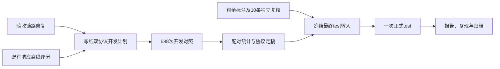

# USIM 预填准确率对照、标注验收与正式 test 长计划

日期：2026-10-28（Asia/Shanghai）。工作区根：`E:\code\UW-VLM`。基于当前提交 `08fbd2f` 和本轮只读复核。

本文件是给后续执行者的完整工作单。本轮只编制计划、读取既有响应并做临时目录中的校验器负例探测，没有发起模型请求，也没有改写旧预测、评分或冻结清单。工作区已有的 README 修改保留。

## 1. 决策与终点

推荐顺序：先修验收链路并补齐既有16题的离线准确率报告，再做同预算的双协议开发对照；test 标注和独立复核同步推进。最终在锁定协议与 test 输入后执行一次正式评测。

不采用“预填四条件跑完，再与历史256比较就判断准确率影响”的设计。预填是明确的请求协议因素，需要和无预填在相同预算、相同输入、接近的调用时段比较。无论差异是否显著，论文和报告都标明协议因素。

本计划的完成标准：

1. 新运行器与核验器能拒绝不完整、重复、漂移或被篡改的实验，且留有负例测试证据。
2. 形成同预算双协议的开发对照、全题分母的主副指标、配对差异和按 episode 分组的不确定性报告。
3. 10条 test 候选都有可追溯的标注与独立质量裁决；不承诺每条都能支持 L5。
4. 最终请求协议、预算、评分、test 标签与输入分别冻结，正式 test 不用于调参。
5. 原始证据完整，命令可复跑，结论不超过数据与样本量支持的范围。



## 2. 已核实的起点与必须更正的事实

本轮机器可读证据：`ENACT/docs/WBW/evidence/prefill_long_plan_audit_20261028.json`。它记录输入文件哈希、逐题预测、临时负例探测和调用数口径。

### 2.1 已有16题可以直接离线评分

无需增加API请求即可用原 v0.3 解析器、冻结副指标和本地 gt 比较已存响应：

| 条件 | 无预填2048严格EM | 预填2048严格EM | 无预填副指标EM | 预填副指标EM |
|---|---:|---:|---:|---:|
| A | 14/16 | 14/16 | 14/16 | 14/16 |
| B | 12/16 | 14/16 | 14/16 | 14/16 |

A的严格解析排列逐题不变；B的副指标提取排列逐题也与预填后的排列一致，均为16/16一致。B的严格EM增加2题，当前样本可由格式恢复解释。该结果属于事后开发诊断，不能证明全量中立、感知等价或因果效果。

必须纠正“2048的3条格式失败结尾全部答对”：forward `ea4ca751` 的 gt 是 **`[1,3,2]`**，散文结尾和预填冒烟输出为 **`[3,1,2]`**，合法但答错。其余两条 `45a760d1`、forward `827185aa` 的末尾答案正确。冒烟通过的是鉴权、续写形态与合法性，不是准确率。

### 2.2 当前冻结核验并非严格全通过

实际运行 `tools/verify_prefill_freeze.py`：32条请求体重建均匹配，但被冻结的 `run_prefill_format_diagnostic.py` 被标为 `changed`；其余4文件匹配，清单payload本轮独立重算匹配。

还存在两个可复现缺陷：

- 在临时目录创建空的 A/B 预测文件和占位 smoke 文件，当前核验器返回 `ok=true`、exit 0，实际只检查了 **0条** 请求体。它缺少完整ID覆盖与最小检查数的硬约束。
- 当前诊断脚本执行 `--summary-only` 会因不存在的 `args.verify_freeze` 抛出 `AttributeError`。这不改变已经保存的32条响应，但说明CLI修改不能直接描述为“无害且已全面核验”。

文件哈希、请求对象摘要和响应／评分核验检验不同对象。32条客户端请求对象可重建是有用证据，不能消除源码漂移，也不能单凭本地摘要声称服务端收到的请求字节已被独立证明。

当前 `body_sha256` 使用排序JSON对象摘要；HTTP函数采用自己的JSON序列化，二者也不应混称同一份线上字节哈希。下一版分别说明对象摘要和发送字节摘要的含义。

旧清单与旧结果原样保留，分别记录“格式gate通过”“请求重建32/32匹配”“文件冻结存在漂移”。不改写历史清单以让它变绿，不补造不存在的原始HTTP响应。当前pilot保留原始续写正文，但完整响应payload未随每条预测一起归档，后续新运行要补齐。

### 2.3 当前数据范围

| split | A/B/C各自题数 | D题数 | episode数 | 单协议请求 | 双协议请求 |
|---|---:|---:|---:|---:|---:|
| dev | 84 | 42，仅forward | 19 | 294 | **588** |
| val | 36 | 18，仅forward | 8 | 126 | 252 |

“4条件 × 84题”不成立。D不含inverse，不得扩造42道题来凑数量，也不得把A的84题总分直接减D的42题总分。

test 目前4/10条形成标注并通过结构／源帧检查，不是4条均完成独立质量验收。`1378` 的 f250仍不能据当前独立目检确认满足“离底间隙至少半物体宽”。

## 3. 工作包P0：先修运行与验收链路

这一包不调用模型。先归档当前提交、清单、相关源码、请求摘要和输入哈希；任何修复都在新版本中实施。

### 3.1 新实现的边界

- 不修改主冻结内的 `run_inference.py`、`evaluate.py`、既有副指标及其冻结文本。
- 将新双协议驱动实现为独立文件，例如 `ENACT/scripts/usim/run_v02_protocol_ablation.py`；这是建议的新文件，当前不存在。
- 核验器独立于运行器，避免为了加验证CLI再改历史冻结运行器；核验器自身仍要有固定版本、测试与源码记录，并非免于版本管理。
- 保留旧prefill清单与漂移记录。若确实能从备份或Git对象找回冻结时原件，可另行归档；无法找回就明确记录，不猜测还原。

### 3.2 新核验器的硬条件

必须同时验证：

1. 清单schema、版本、payload摘要及所有必需文件哈希；任一缺失／变化均非零退出。
2. 计划、QA、图片、模型／解码、固定拼接规则与源码相容；不是只检查文件存在。
3. 每个单元的预测ID集合与对应冻结QA**完全相等**；重复、未知、缺失ID分别报错。当前pilot应是A16、B16，共32个唯一单元。
4. 重建请求数量必须等于计划数量，且每条摘要匹配；0条匹配不能算通过。
5. 原始续写与 `completed_answer` 按固定规则一致，重新运行解析器所得状态与存储状态一致。不得依据gt或解析成功与否选择拼接方式。
6. 模型HTTP结果、停止原因、格式是否合法、答案是否正确分开记录。HTTP成功不能替代后面三项。
7. 原始响应和usage可追溯。新运行保存完整响应payload；只有摘要而无原件的历史项标明材料限制。

必要负例：空预测、少一题、重复ID、未知ID、QA或图像改变、payload篡改、源码漂移、前缀重复、拼接文本被修补、失败HTTP却带合法列表、截断却带闭合列表、续跑配置变更。每种负例都必须被拒绝或按预定规则计0，不能默许缩小分母。

特别区分：截断时即使恰有闭合列表，预算／格式gate仍失败，副指标仍按 `finish_reason` 计0；主指标的处理严格沿用 v0.3 已有加载与解析契约，不在派生适配层偷偷改变解析器行为。解析合法、正常停止和最终答对是不同状态。

### 3.3 运行器要求

- 准备、执行、离线分析、核验四个入口各自独立。准备／分析／核验不得读取密钥后意外发请求。
- 请求前校验新冻结；每次续跑重新校验。格式错误和答错不是重试理由。
- 传输重试仅限预先声明的暂时性错误，最多3次；401/403、请求配置错误或资产错误应停止。终态失败保留；不得只补成功的一次覆盖它。
- 正式记录 `started_at`、`finished_at`、耗时、attempt、request_id、模型返回名。别名返回名不冒充不可变快照。
- 默认只准备，显式执行选项才联网；新运行器在没有付费调用的情况下必须先通过故障注入测试。

验收产物：代码、测试、负例证据、严格核验JSON，以及新的开发对照冻结清单。不要为了补测试改旧冻结文件。

## 4. 工作包P1：形成现有pilot的完整离线评分报告

本轮已算出2.1的计数；下一执行阶段把它补成标准评分器可复跑的报告，不需要重新请求模型。

1. 从源QA取ID、题型、episode、状态数，验证两运行ID一一对应。
2. 为原prefill预测建立**派生**评分输入：`answer`来自已经固定的 `completed_answer`，同时保留原文件哈希和原始续写索引。不要给旧预测补写字段。
3. 在独立分析目录保存派生 `run_config`、标准预测和评分报告，使原 `evaluate.py` 与统计工具可读取。
4. 主指标用 v0.3 全题分母；副指标仍用原冻结版本，独立报告合法率、可提取率和全题EM。条件于可提取子集的准确率只作带分母的辅助描述。
5. 列出逐题配对：两者均对、仅预填对、仅无预填对、两者均错；再列两者均可提取时的排列一致性，不能把它替代全题分母。
6. 标注 `post_hoc=true`，不得因为现在补了gt评分就改写原格式gate，亦不以这16题证明预填中立。

建议产物：`ENACT/docs/WBW/evidence/prefill_pilot_accuracy_v1/` 下的 `summary.json`、`paired_items.jsonl`、`report.md` 和输入／源码摘要。

## 5. 工作包P2：冻结同预算双协议开发矩阵

### 5.1 因素与数量

协议因素只有两个水平：

- P0：无预填，原无system策略与user格式指令。
- P1：相同user内容后追加 `{"role":"assistant","content":"[","partial":true}`，完整回答固定为前缀加原始续写。

为避免与“工作包P0/P1”混淆，文件目录用 `no_prefill`、`prefill`，不要只用P0/P1命名。

两个水平都使用2048作为**本次对照的实验预算**，不是自动确定的最终统一预算。模型、接口、thinking=false、temperature=0、图像、超时、传输策略和评分保持相同。暂不再叠加system message或其他格式技巧。

| 单元 | no_prefill | prefill | 合计 |
|---|---:|---:|---:|
| A 原图 | 84 | 84 | 168 |
| B 复合图 | 84 | 84 | 168 |
| C 去图文本 | 84 | 84 | 168 |
| D 去动作文本，仅forward | 42 | 42 | 84 |
| 总计 | 294 | 294 | **588** |

历史256全量只作历史背景。现有2048小样本也不能拼接进新全量，冒充一次同版本、同时间段的完整对照。

### 5.2 输入与请求检查

- A/B/C使用原dev84题；D使用其forward42题子集。D的文本必须来自既有去动作文本构造，不临时重写语义。
- 同一条件在两协议间，ID、gt、状态数、题干与图片完全一致；仅追加的assistant消息不同。
- C请求体实际图片数必须为0；不能仅看CLI用了drop-images。D必须确认动作语义文本确已移除。
- 请求只包含原题干、规定格式指令、显示顺序图片和固定前缀；gt、文件名、episode ID、时间戳和关节信号留在本地。
- 本地输入、图片和代码摘要写入新清单，原 `v02_dev_001/inputs/` 不新增文件，避免破坏主冻结。

### 5.3 时间顺序与独立性

将每个“条件×题目”作为一个配对单元，共294个单元。冻结seed和顺序，同题两个协议相邻调用，第一协议顺序在294个单元中各占一半；在单元间按固定seed打乱。

每次请求都是独立消息上下文，不能把一个协议的回答放进另一协议。采用串行限速；保留两次调用时间、返回模型名和request_id。这样减少时间漂移混杂，但仍不能保证别名底层快照固定。

### 5.4 冒烟与冻结

新驱动新增C/D支持，不能只沿用旧A/B冒烟。先离线检查全部588个请求的形态，再对8个单元（两协议×四输入条件）各做至多1次独立兼容性冒烟。

这些最多8次不计入正式指标；只依据接口、完整性与格式判定兼容性，不按EM挑选题目或参数。之后冻结请求、拼接、输入、预算、源码、测试和执行顺序，再执行588次。若准备阶段失败，不发正式请求。

## 6. 工作包P3：执行与评分

建议新根目录：`ENACT/data/usim_enact/runs/qwen3.8-max/v02_protocol_ablation2048_dev_v1/`。

```text
plan.json
inputs/                         # 本次QA副本及图像清单
no_prefill/{A_full_image,B_zoom,C_text_only,D_no_action_text}/
prefill/{A_full_image,B_zoom,C_text_only,D_no_action_text}/
    predictions.jsonl           # 标准化answer、状态、来源引用
    responses.jsonl             # 每次完整原始响应
    attempts.jsonl              # 所有传输尝试
    run_config.json
    run_status.json
    report.json
    report.items.jsonl
analysis/
    integrity.json
    protocol_effects.json
    input_effects.json
    report.md
```

原始续写与拼接后的回答都保留。缺失、截断、解析失败和传输终态失败都贡献分母；不从“有效回答”子集计算主EM。

两类gate分开：

- **实验完整性gate**：输入、ID、配置、数据完整性或冻结出错，停止并修基础设施。
- **候选预填协议格式gate**：按事先标准检查预填单元的停止与格式；无预填控制中的格式失败是观测结果，保留计0，不因它不通过格式gate就删除整个控制条件。

即使预填全量出现格式失败，也不能只重跑失败题。分析本次观测，保留所有结果；需要另一种协议时，另开版本与完整计划。

## 7. 工作包P4：回答“预填影响了什么”

### 7.1 报告内容

对每个协议和条件报告：N、episode数、HTTP失败／缺失、停止原因、严格合法率、可提取率、主EM、TA、PA_item、PA_transition_micro、副指标全题EM，以及input/output tokens和延迟分布。

主表使用全题分母，舍入只发生在展示时。保存整数计数和未舍入的差值，不用两个四位小数相减作为精确效应。

### 7.2 预先声明的对比

1. 每个条件内的协议效应：预填减无预填，分别计算严格EM、全题副指标EM和格式合法率变化。
2. 每个协议内的输入效应：A−B、A−C、A−D。A−D严格限制在共同42道forward题；任何含D的四条件表都使用这个共同范围。
3. 分方向、L、任务类型及“程序文本基线答对／答错”分层；每行写实际N。不得把基线答错称为所有文本方法不可解。
4. 视觉证据优先看forward、较长题和文本基线答错层。inverse得分不能单独支持视觉能力结论。
5. 协议与图像条件交互：比较B的协议效应是否大于A；严格EM与副指标EM分开，区分格式恢复和可提取答案内容变化。

全题副指标仍可能受不可提取输出影响，不称为“纯感知准确率”。两协议均可解析题上的排列变化用于案例诊断，必须同时给出共同子集大小，不能代替主指标。

### 7.3 不确定性与结论界限

使用按 `task_name/episode` 的配对bootstrap：两协议及同episode内方向／长度一起抽样，建议10000次，seed在执行前固定。dev只有19个episode，应报告区间及样本限制。

逐题McNemar计数可作描述；若提供显著性检验，不能把同episode多题当独立样本，优先使用适当的cluster方法。多项探索比较标明范围，不挑出显著项写成唯一结论。

“未显著”不等于“无影响”。默认不主张等价或中立；若文章确要等价／非劣结论，须在新确认数据前确定实际有意义的界值并做功效分析。当前84题／19簇和D42题通常不足以支持很窄的等价界值，不能事后放宽界值。

协议采用规则：先看执行可靠性、格式行为和研究问题，再综合准确率变化；不以让B接近A或提高主表数值为目标。无论差异是否显著，预填都作为明确的请求干预报告，而不是隐藏的修补。

### 7.4 val的角色

默认调用范围只含588次dev对照。若需要独立验证协议效应，val的双协议矩阵另需252次；必须在dev付费执行前登记是否纳入、用途与判据，并核验val此前未用于模型／提示选择。

不得看dev的p值后，临时决定是否增加val来追求显著或不显著。8个val episode也不能自动解决等价检验的功效问题。若不执行该扩展，完整报告开发对照的探索性质，不冒充确认结果。

## 8. 工作包P5：并行完成test标注与独立验收

### 8.1 剩余工作

剩余6条：`1734 / 1259 / 1273 / 1145 / 1497 / 1549`。已有 `1078 / 1650 / 1384 / 1378` 仍需质量验收，不是只检查新增6条。

标注执行与API运行没有依赖。可在等待API时推进；独立复核由未参与首次判断的复核者按既有规范实施，不把同一执行者重读一次当作独立双标。

### 8.2 每条交付

- 原视频／Parquet来源与hash，候选事件和渲染保持段。
- 独立逐帧spec、事实与可见性，ego证据说明；腕相机／DVL仅标为辅助。
- 关键帧角色、所在保持段、相邻语义diff和非空检查。
- `annotate_episode --check --verify-frames`结果；另列独立视觉裁决，二者不合并成一个“通过”。
- 原始意见、分歧、最终裁决与原因，保留失败或降级记录。

### 8.3 1378的具体裁决路径

只在现有事件窗口与稳定性规则内寻找可用lift证据；不能因为f250较弱就挑窗口外的“更好看”帧，也不能把DVL的0.099m直接当成物体离底间隙。

复核者独立检查ego是否满足至少半物体宽间隙，且与grasp帧形成可见差异。能够确认才接受；不能确认则保留待定或调整可支持的题长，并重新审计相邻转移。若更基础状态也不成立，按test前的可用性规则记录不适用，不能为维持10条或L5配额强行赋值。

`at_box`继续沿用既有 `NearBox(robot,green_box)` 通道：箱可见、release前15±5帧、保持段≥8帧、物体仍被持有且已离底、相对位置有可见变化，不声称InBox。L5数量服从证据，不能反过来决定标签。

全部test标注与裁决不参考任何test模型输出。需要补选episode时，只能在test调用前依据已声明的可用性／抽样规则处理，并保存被替换条目的记录。

## 9. 工作包P6：两层最终冻结

### 第一层：运行与评分协议

在任何test模型请求前，锁定最终选择的请求协议、预算、模型别名／可用版本信息、endpoint、无system或其他既定策略、前缀与固定拼接、传输策略、主副指标、分母、失效处理、统计对比及所有源码与测试。

2048在本次开发对照中是实验控制值；只有通过既定选择流程后，才写为最终test预算。不能从16题格式通过直接宣称整个任务已选定预算。

### 第二层：test数据与输入

建议新建独立release，例如 `ENACT/data/usim_enact/usim-enact-v0.2-test-r1/`，不要把新test图、标签或QA追加到已冻结dev/val根目录。

标签schema、数据release名、请求协议和评分版本分开记录；创建前核对构建脚本接口，不因目录名变化就假定schema升级。

冻结：纳入／排除的episode、标注与复核、源帧与图像、题集构造／重排／筛选seed、A/B/C题集、D的forward子集、所有输入hash，以及与dev/val零重叠的检查。先做oracle、唯一性与可见非空转移审计，再写最终清单并核验。

不能预先承诺test题数或L5数。以实际通过视觉验收的episode与冻结构造规则生成，清单必须给出每方向、L和episode的计数。

## 10. 工作包P7：一次正式test与交付

默认只用最终选定的一个协议，A/B/C/D各执行一次，程序基线离线计算。若文章还要在test检验协议因素，必须在调用前额外登记两个协议，不得看完主test成绩再补对照。

若test总题数为T、forward题数为F，则：

- 单协议模型请求数为 `3T + F`。
- 双协议模型请求数为 `6T + 2F`。

test中遇到格式失败或低准确率照实计分，不调prompt、预算、图像裁剪或解析规则。基础设施故障只按已冻结重试策略处理，恢复记录可追溯。若test后发现标签错误，保留旧release并升级后对所有条件统一重评，不能只删除答错题。

最终交付：主副指标并列表、方向／L／任务／基线分层、共同forward对比、episode级区间、失败原因、token／延迟、全部运行ID与配置、来源许可与复现说明。论文中的预填协议明确标注，不推断内部推理是否消失；外显token减少只能说明外显输出变化。

## 11. 配额、时间与执行边界

| 项目 | 新逻辑请求上限 |
|---|---:|
| 当前计划与离线评分／链路修复 | 0 |
| 新驱动两协议×四条件兼容性冒烟 | 最多8 |
| 推荐核心dev对照 | **588** |
| 事前登记的val扩展，默认未纳入 | 另加252 |
| 正式test，单协议 | `3T + F` |

核心开发阶段上限596次逻辑请求。若每次最多3次传输尝试，则HTTP尝试上限1788；格式失败不会触发该重试。588次正式请求在2048上限下的输出token理论上限是1,204,224，图像／文本输入token另计，不把这个上限当成预计账单。

先从既有usage估算输入规模和价格，再在执行日志记录实际用量；不凭模型别名猜费用。当前任务只形成计划，不启动上述付费阶段。

建议按里程碑安排3–5个工作日，实际取决于独立复核：第一段完成离线评分、P0修复与新冻结；第二段执行开发矩阵并同时标注；第三段完成统计、协议选择和test裁决；最后冻结test、执行并归档。API运行时间与人工验收时间分开估算，不以旧32题耗时承诺全流程完成时刻。

## 12. 现有命令与待实现接口

以下只读命令当前存在：

```powershell
Set-Location 'E:\code\UW-VLM'
$py = 'C:\Users\whuang\.workbuddy\binaries\python\envs\default\Scripts\python.exe'

& $py ENACT/scripts/usim/freeze_extractable_v1.py --verify ENACT/docs/protocols/extractable_permutation_v1.freeze.json
& $py -m unittest discover -s tools -p 'test_*.py' -v
```

旧 `verify_prefill_freeze.py` 可复现当前报告，但其 `ok` 不能作为新付费运行的准入；旧诊断脚本的 `--summary-only` 当前有已记录的CLI错误。

新驱动目标接口是prepare／execute／analyse／verify；目前尚未实现，不在这里给出可误执行的伪命令。实现完成后，执行手册必须列出与 `--help` 一致的准确命令、默认离线行为、job_count、输出目录和冻结ID。

密钥继续从进程环境读取，缺失时读取Windows当前用户持久变量，不打印值，不写入命令行、日志或仓库。

## 13. 给执行者的优先级与回报格式

立即开始的零调用工作：更正文档中“3条结尾全对”和“请求摘要替代文件冻结”的表述；补标准化离线评分；修复并测试运行／校验链路；同时推进剩余标注和10条独立裁决。

只有P0与新冻结通过后进入588次开发对照。既有格式pilot不用重跑；不重复花配额证明已确认的A/B兼容性，新增冒烟只验证新驱动的8个执行单元。

每次回报只需包含：本轮完成的工作包、实测证据路径、状态与非零退出码含义、新增请求数、实际输入／输出token、剩余阻塞、下一步。准备好不等于已执行，结构检查不等于视觉验收，文件漂移不等于完整冻结通过，未显著不等于等价。

提交时仅纳入本次明确产物，保留并发README修改；不把原始录制、模型权重、密钥或临时复核PNG加入Git。不force-add被忽略的数据。发布前在隔离环境检查可复现入口与资产可获得性，再按工作区约定记录日志、变更和普通提交／推送。
